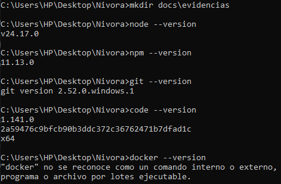
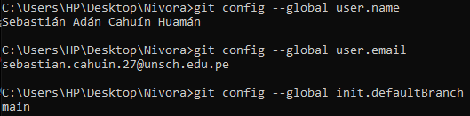
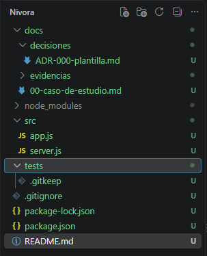

# Nivora

## Datos académicos

- **Estudiante:** Sebastián Adán Cahuín Huamán.
- **Asignatura:** IS-488 — Arquitectura de Software.
- **Docente:** Ing. Lizbeth Jaico Quispe.
- **Universidad:** Universidad Nacional de San Cristóbal de Huamanga.
- **Semestre:** 2026-II.

## Descripción del curso

El curso aborda la organización y estructura de los sistemas de software,
sus componentes y las decisiones que permiten atender requisitos de
seguridad, rendimiento, disponibilidad y mantenibilidad.

## Expectativas del estudiante

Espero aprender a estructurar un proyecto de software y justificar
sus decisiones arquitectónicas. También quiero mejorar el uso de Git
y GitHub para registrar los avances y mantener organizada la documentación
junto con el código.

## Proyecto

**Nivora: Sistema para el monitoreo del consumo de agua potable.**

Nivora permitirá consultar el consumo de agua desde celulares, laptops,
computadoras y otros dispositivos. Mostrará el consumo acumulado,
su costo estimado, una proyección mensual, el historial y las estadísticas.

También permitirá consultar los recibos mensuales y recibir notificaciones
en el dispositivo sobre consumo elevado y disponibilidad del recibo.

Durante esta primera etapa se utilizará una API simulada que represente
al sistema de la empresa de agua. La capacidad del sistema se evaluará
mediante pruebas con 5000 usuarios simultáneos.

El proyecto se desarrollará progresivamente siguiendo las guías
del curso de Arquitectura de Software.

## Caso de estudio

La descripción del problema, el funcionamiento y el alcance inicial
se encuentran en [Caso de estudio de Nivora](docs/00-caso-de-estudio.md).

## Dependencias instaladas

- **Express 5.3.0:** dependencia de producción para el servidor web.
- **nodemon 3.1.14:** herramienta de desarrollo para reiniciar el servidor.

## Revisión de dependencias

La ejecución de `npm audit --omit=dev` reportó cero vulnerabilidades
en las dependencias de producción.

Queda pendiente el seguimiento del aviso de seguridad de `braces`,
dependencia indirecta de nodemon.

Referencia: https://github.com/advisories/GHSA-vfj7-8cjw-p6xm

## Evidencias del laboratorio 01

### Verificación de versiones

### Configuración de Git

### Creación del proyecto y estructura base

