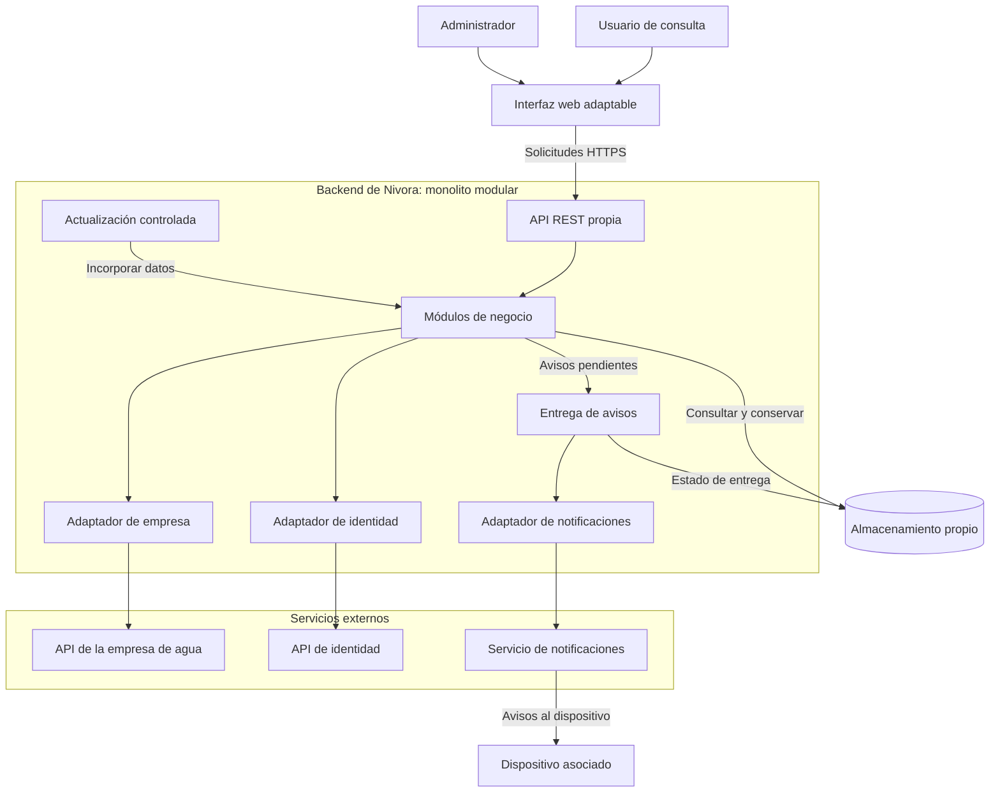

# Estilo arquitectónico de Nivora

## Estilo seleccionado

Nivora utilizará un monolito modular para su backend:
una aplicación desplegable que organiza sus funcionalidades
en módulos con responsabilidades y límites definidos.

Las interfaces adaptadas a distintos dispositivos
se comunicarán con este backend mediante una API REST propia.

Las reglas de consumo, costos, proyecciones y alertas
se mantendrán centralizadas para proporcionar resultados
consistentes desde celulares, laptops y computadoras.

La organización interna seguirá Clean Architecture,
según ADR-002.

## Componentes principales

| Componente | Responsabilidad |
|------------|-----------------|
| Interfaz web adaptable | Recibir las acciones del usuario y presentar consumo, estimaciones, historial, recibos y avisos. |
| API REST propia | Recibir solicitudes, comprobar sesiones y permisos y ejecutar los casos de aplicación. |
| Módulos del backend | Coordinar las funciones de Nivora y aplicar sus reglas de negocio. |
| Almacenamiento propio | Conservar los datos aceptados, configuraciones, recibos, avisos, dispositivos, accesos e incidencias. |
| Actualización controlada | Obtener datos externos e incorporarlos mediante validaciones y controles de duplicados. |
| Entrega de notificaciones | Procesar los avisos pendientes y enviarlos a los dispositivos asociados. |
| Adaptadores externos | Comunicar Nivora con la empresa de agua, la API de identidad y el servicio de notificaciones. |

## Módulos del backend

| Módulo | Responsabilidad |
|--------|-----------------|
| Acceso y suministros | Validar el suministro y el DNI, gestionar sesiones, registrar accesos y separar las operaciones administrativas. |
| Lecturas, consumo e historial | Incorporar y validar lecturas, controlar duplicados, calcular consumos y preparar periodos, historial y estadísticas. |
| Tarifas, costos y proyecciones | Gestionar versiones tarifarias y calcular costos estimados y proyecciones mensuales. |
| Alertas y notificaciones | Comparar consumos, registrar avisos, gestionar dispositivos y coordinar las entregas. |
| Recibos | Obtener los recibos de la empresa y presentar sus importes, disponibilidad y fechas límite. |

Los módulos utilizarán interfaces definidas y respetarán
los límites de sus responsabilidades.

## Relaciones principales

La interfaz utilizará la API propia para acceder a Nivora.

Durante el acceso de consulta, el backend verificará
el código de suministro y el DNI mediante sus integraciones.
La sesión se creará después de completar las validaciones,
sin exigir que la persona sea titular del suministro.

Las consultas utilizarán las lecturas y tarifas aceptadas
en el almacenamiento propio.

El módulo de consumo proporcionará los datos necesarios
para calcular costos, proyecciones y condiciones de alerta.

El módulo de recibos comunicará la disponibilidad
de nuevos recibos al módulo de alertas y notificaciones.

La entrega de avisos utilizará el servicio externo
sin depender de que el usuario mantenga abierta la interfaz.

## Integraciones externas

| Integración | Datos u operaciones |
|-------------|---------------------|
| Empresa de agua | Suministros, lecturas, tarifas y recibos. |
| API de identidad | Existencia del DNI y datos asociados al documento. |
| Servicio de notificaciones | Entrega de avisos a dispositivos con suscripción y permiso habilitados. |

Cada integración utilizará un adaptador del backend.

Los medidores inteligentes, la infraestructura de comunicación
y los sistemas internos de la empresa están fuera
de la responsabilidad de Nivora.

Los importes definitivos procederán de los recibos de la empresa.
Los costos acumulados y las proyecciones de Nivora
se presentarán como estimaciones.

El procesamiento de pagos se realizará fuera de la aplicación.

## Actualización y continuidad

La actualización externa se separará de las consultas,
conforme a ADR-003.

Si la empresa no responde, las sesiones vigentes podrán
consultar los datos almacenados, acompañados de su fecha
y estado de actualización.

La recuperación de información pendiente conservará
las validaciones y los controles de duplicados.

Un fallo de entrega de notificaciones no eliminará
los avisos internos ni bloqueará las consultas.

## Diagrama de arquitectura global

El diagrama muestra relaciones de comunicación y procesamiento.
Las dependencias entre las capas internas se documentarán
en el enfoque arquitectónico.

La actualización y la entrega de avisos pertenecen
a la organización inicial del backend; no representan
microservicios desplegados independientemente.

La recepción en el dispositivo dependerá de sus permisos,
conectividad y compatibilidad con el mecanismo utilizado.

## Capacidad y evolución

El sistema deberá atender 5000 usuarios simultáneamente
mientras continúan las actualizaciones y la evaluación de alertas.

La capacidad deberá comprobarse mediante las pruebas
definidas en los atributos de calidad.

Si se necesitan varias instancias, se requerirán
almacenamiento y sesiones compartidos, además de coordinación
de las tareas de actualización y notificación.

El estilo seleccionado no determina por sí solo
la infraestructura necesaria ni garantiza esa capacidad.

## Relación con el boilerplate

El boilerplate utiliza Node.js y Express para la API propia,
junto con una interfaz web adaptable.

La empresa y la identidad se representan mediante API locales
con datos ficticios. El adaptador Web Push está incluido,
pero su recepción externa requiere configuración y comprobación.

El almacenamiento JSON y las sesiones en memoria
son implementaciones locales para una sola instancia.

El diagrama expresa el diseño del sistema objetivo.
El boilerplate demuestra su organización inicial y varios flujos;
todavía no implementa todos los requisitos ni acredita
la capacidad de 5000 usuarios.

La arquitectura inicial del laboratorio 02 se conserva
como antecedente de esta evolución.

## Decisiones relacionadas

- [ADR-001: Monolito modular](../docs/decisiones/ADR-001-monolito-modular.md)
- [ADR-002: Clean Architecture](../docs/decisiones/ADR-002-clean-architecture.md)
- [ADR-003: Actualización y continuidad](../docs/decisiones/ADR-003-actualizacion-y-continuidad.md)
- [ADR-004: Integraciones externas](../docs/decisiones/ADR-004-integraciones-externas.md)