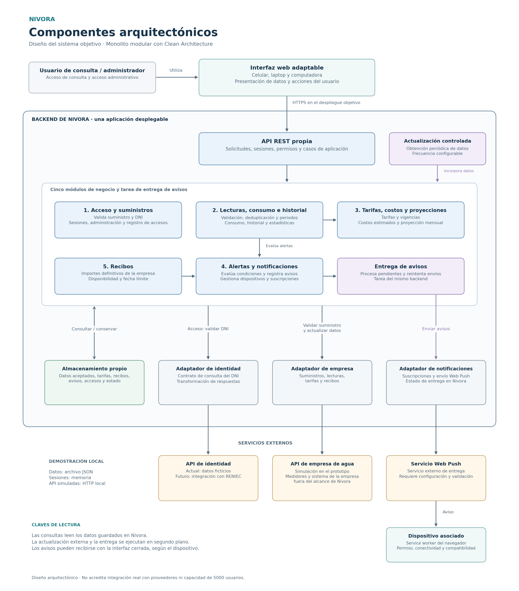

# Componentes arquitectónicos de Nivora

## Propósito y alcance

Este documento detalla los componentes que colaboran para consultar
el consumo de agua, presentar estimaciones y recibos, y entregar avisos.
Desarrolla la arquitectura de monolito modular definida en los laboratorios
anteriores y conserva sus cinco módulos de negocio.

El diagrama representa el diseño del sistema objetivo. El prototipo utiliza
API simuladas para la empresa de agua y la identidad. Los medidores
inteligentes, su comunicación y los sistemas internos de la empresa
pertenecen a la infraestructura externa prevista para el proyecto.

## Diagrama de componentes

[Abrir versión vectorial del diagrama](../img/componentes-nivora.svg)

La frontera del backend agrupa una sola aplicación desplegable.
La actualización controlada y la entrega de avisos son tareas de ese
backend. Las flechas muestran colaboración durante la ejecución;
las dependencias internas de Clean Architecture se explican en el
[enfoque arquitectónico](enfoque-arquitectonico.md).

Las flechas que salen del grupo de módulos resumen sus conexiones
compartidas. Cada operación utiliza únicamente los componentes
necesarios, según las responsabilidades siguientes.

## Presentación y entrada al backend

| Componente | Responsabilidad |
|------------|-----------------|
| Interfaz web adaptable | Permitir la consulta y las operaciones administrativas desde celular, laptop y computadora. Presentar consumo, historial, estimaciones, recibos, avisos y estado de actualización. |
| API REST propia | Recibir solicitudes, validar parámetros, sesiones y permisos, y dirigir cada operación a su caso de aplicación. Mantener separados los permisos de consulta y administración. |

La interfaz se comunica con la API de Nivora. Las credenciales de las
integraciones externas permanecen en el backend.
El despliegue objetivo utilizará HTTPS; la demostración local utiliza HTTP.

## Módulos de negocio

| Módulo | Responsabilidad | Requisitos relacionados |
|--------|----------------|-------------------------|
| 1. Acceso y suministros | Validar el código de suministro y el DNI mediante las integraciones correspondientes, gestionar sesiones, registrar los accesos y ofrecer las operaciones administrativas de suministros y accesos. | RF01–RF04, RF30, RF31 |
| 2. Lecturas, consumo e historial | Validar e incorporar lecturas, controlar duplicados, calcular consumos en litros y m³, organizar periodos y preparar el historial y las estadísticas. Supervisar la actualización y sus incidencias. | RF05–RF14, RF19–RF21, RF32, RF35–RF37 |
| 3. Tarifas, costos y proyecciones | Gestionar tarifas y vigencias, calcular el costo acumulado estimado y proyectar el consumo y costo al finalizar el mes. Identificar las lecturas, tarifas y supuestos utilizados. | RF15–RF18, RF33 |
| 4. Alertas y notificaciones | Comparar el consumo mensual con el mes anterior cuando existan datos suficientes, registrar avisos, gestionar dispositivos y suscripciones, y coordinar las entregas y la consulta de avisos. | RF22–RF26, RF34 |
| 5. Recibos | Obtener y organizar los recibos de la empresa, mostrar sus importes definitivos y fechas, y comunicar la disponibilidad de un recibo al módulo de notificaciones. En la demostración, aplicar el plazo de una semana desde su disponibilidad. | RF27–RF29 |

El acceso de consulta acepta un suministro existente y un DNI válido,
sin exigir que la persona sea titular del suministro. El registro conserva
el documento utilizado, los datos devueltos por la API y la fecha y hora.
Consultar esos datos no demuestra quién introdujo físicamente el DNI.

Los costos acumulados y las proyecciones de Nivora se presentan como
estimaciones. El importe definitivo procede del recibo de la empresa.

## Actualización, almacenamiento y entrega

| Componente | Responsabilidad |
|------------|-----------------|
| Actualización controlada | Obtener periódicamente los datos de la empresa mediante su adaptador. Coordinar su validación e incorporación, el control de duplicados y el registro del estado de la integración. |
| Almacenamiento propio | Conservar los datos aceptados, las versiones tarifarias, los recibos, las configuraciones, los avisos, los dispositivos, los accesos y las incidencias. Permitir consultar información conservada durante un fallo externo. |
| Entrega de avisos | Procesar los avisos pendientes mediante el adaptador de notificaciones, registrar el resultado e intentar nuevamente los envíos que corresponda. Mantener los avisos internos aunque falle la entrega externa. |

Los módulos acceden a la persistencia mediante el contrato de repositorio.
Las sesiones utilizan su contrato de gestión correspondiente.
En el prototipo, los datos se conservan en un archivo JSON y las sesiones
se mantienen en memoria para una sola instancia. La selección del
almacenamiento de un despliegue mayor requiere pruebas y una decisión
de infraestructura.

La fecha de la última medición y el estado de actualización acompañan
los resultados. La incorporación de un duplicado o un reintento no debe
incrementar artificialmente el consumo ni generar el mismo aviso otra vez.

## Integraciones externas

| Adaptador del backend | Servicio externo | Uso en Nivora |
|----------------------|------------------|---------------|
| Adaptador de empresa | API de la empresa prestadora de agua | Validar suministros y obtener lecturas, tarifas y recibos. El prototipo utiliza una API simulada. |
| Adaptador de identidad | API de identidad | Validar la existencia del DNI y obtener sus datos. El prototipo utiliza personas ficticias; la integración con RENIEC se plantea para una etapa posterior y requiere definir y verificar el servicio correspondiente. |
| Adaptador de notificaciones | Servicio Web Push | Enviar avisos a las suscripciones de los dispositivos asociados y registrar el resultado del envío. |

Los adaptadores implementan contratos del núcleo y traducen los datos
y errores particulares de cada proveedor. Sustituir una fuente simulada
por una real requiere implementar y comprobar su adaptador.
Los escenarios de simulación permiten estudiar RF38 y RF39.

En la arquitectura futura, los medidores enviarán sus datos al sistema
de la empresa. Nivora obtendrá esa información mediante la API de la
empresa, conforme al contrato que se acuerde con ella.

El service worker del navegador recibe los eventos Web Push.
La recepción con la interfaz cerrada depende del permiso, la conectividad,
la compatibilidad y las condiciones del navegador y del dispositivo.
La aceptación del envío por el servicio externo no demuestra que el aviso
se haya mostrado en pantalla.

La posibilidad de pagar recibos mediante Yape corresponde a una ampliación
futura, sujeta a seleccionar una integración compatible. El procesamiento
de pagos permanece fuera del alcance actual.

## Colaboraciones principales

1. **Inicio de sesión:** la interfaz envía el suministro y el DNI a la API
   propia. El módulo de acceso utiliza los adaptadores de empresa e
   identidad. Cuando las validaciones se completan, registra el acceso
   y crea la sesión. La administración utiliza su autenticación y permisos.
2. **Consulta del panel:** la API verifica la sesión y ejecuta los casos
   de consulta. Los módulos utilizan los datos aceptados del almacenamiento
   propio para preparar consumo, historial, estimaciones y recibos.
3. **Actualización en segundo plano:** el proceso controlado obtiene datos
   mediante el adaptador de empresa. Los módulos validan e incorporan
   lecturas, tarifas y recibos, conservando el control de duplicados
   y la trazabilidad de los resultados.
4. **Evaluación de avisos:** el consumo alimenta los cálculos de costos
   y las condiciones de alerta. La disponibilidad de un recibo se comunica
   al módulo de alertas y notificaciones. Los eventos generan avisos
   identificados para evitar duplicados.
5. **Entrega al dispositivo:** la tarea de entrega utiliza el adaptador
   Web Push y conserva el estado de cada intento. Los avisos también
   permanecen disponibles dentro de Nivora.
6. **Fallo externo:** las sesiones vigentes consultan los datos conservados
   con su fecha y estado. La actualización se recupera mediante reintentos
   controlados. Un nuevo acceso que necesite una API no disponible debe
   informar que no pudo completar la validación.

Las consultas y la actualización externa se ejecutan por separado,
conforme a ADR-003. Una consulta del panel no exige obtener una lectura
nueva de la empresa para poder responder.

## Correspondencia con el boilerplate

| Elemento del diseño | Archivos de referencia en `tecnologia/nivora-boilerplate/` |
|--------------------|-----------------------------------------------------------|
| Interfaz y entrada REST | `src/presentacion/web/` y `src/presentacion/api.js` |
| Casos de aplicación | `src/aplicacion/iniciar-sesion.js`, `consultar-panel.js`, `actualizar-datos.js`, `administracion.js` y `notificaciones.js` |
| Reglas y contratos del núcleo | `src/dominio/` y `src/dominio/contratos/puertos.js` |
| Adaptadores de empresa e identidad | `src/infraestructura/fuentes-http.js` |
| Persistencia y sesiones | `src/infraestructura/repositorio-archivo.js`, `repositorio-memoria.js` y `sesiones-memoria.js` |
| Envío y recepción Web Push | `src/infraestructura/notificador-web-push.js` y `src/presentacion/web/sw.js` |
| Composición y tareas periódicas | `src/app.js` y `src/server.js` |
| Servicios simulados | `simulacion/servidor.js` y `simulacion/datos.js` |

Los módulos representan responsabilidades del diseño. La tabla identifica
archivos que participan en ellas; no implica que cada módulo disponga
ya de una carpeta propia ni que todos sus requisitos estén implementados.

La integración real con proveedores, la recepción en dispositivos físicos
y la capacidad de 5000 usuarios simultáneos requieren sus verificaciones
correspondientes. Este diagrama documenta la organización del sistema.

## Trazabilidad

- [Arquitectura inicial](arquitectura-inicial.md)
- [Estilo arquitectónico](estilo-arquitectonico.md)
- [Enfoque arquitectónico](enfoque-arquitectonico.md)
- [Escenarios de atributos de calidad](../01-analisis-de-sistema/08-escenarios-atributos-calidad.md)
- [ADR-001: Monolito modular](../decisiones/ADR-001-monolito-modular.md)
- [ADR-002: Clean Architecture](../decisiones/ADR-002-clean-architecture.md)
- [ADR-003: Actualización y continuidad](../decisiones/ADR-003-actualizacion-y-continuidad.md)
- [ADR-004: Integraciones externas](../decisiones/ADR-004-integraciones-externas.md)
