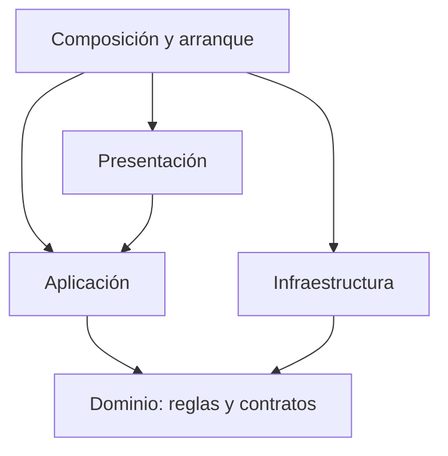

# Enfoque arquitectónico de Nivora: Clean Architecture

## Enfoque seleccionado

Nivora utilizará Clean Architecture para organizar
las responsabilidades y dependencias internas del backend.

Este enfoque complementa el monolito modular:
el estilo arquitectónico define la organización global,
mientras que Clean Architecture establece cómo se separan
las reglas, los casos de uso y los mecanismos externos.

La decisión se encuentra documentada en ADR-002.

## Capas del sistema

| Capa | Responsabilidad | Elementos del boilerplate |
|------|-----------------|--------------------------|
| Presentación | Recibir solicitudes y presentar sus resultados. | API Express e interfaz web adaptable. |
| Aplicación | Coordinar los casos de uso mediante las reglas y contratos del núcleo. | Acceso, consultas, actualización, administración y notificaciones. |
| Dominio | Definir las reglas de negocio y los contratos necesarios. | Validación, lecturas, periodos, costos, proyección y comparación para alertas. |
| Infraestructura | Implementar almacenamiento, sesiones y comunicación con servicios externos. | Repositorio JSON, sesiones en memoria, adaptadores HTTP y Web Push. |

## Dominio

El dominio contiene las reglas que determinan
qué datos y cálculos son válidos para Nivora.

En el boilerplate:

| Archivo | Responsabilidad |
|---------|-----------------|
| `acceso.js` | Validar el formato del código de suministro y del DNI. |
| `lecturas.js` | Validar lecturas y calcular consumos acumulados o por intervalos. |
| `periodos.js` | Delimitar meses en la zona horaria de Lima y determinar el plazo del recibo de demostración. |
| `calculos.js` | Calcular costos, proyectar consumos y comparar el mes actual con el anterior. |
| `errores.js` | Representar errores del núcleo sin asignarles detalles HTTP. |
| `contratos/puertos.js` | Definir las operaciones que el núcleo necesita de sus adaptadores. |

El dominio no importa Express, clientes HTTP,
acceso a archivos ni bibliotecas de notificaciones.

Los cálculos de consumo, costo y proyección
no se duplican en la interfaz web.

## Aplicación

La aplicación coordina los pasos necesarios
para ejecutar cada caso de uso.

| Caso de aplicación | Responsabilidad |
|--------------------|-----------------|
| Iniciar sesión | Validar los campos, consultar suministro e identidad, registrar el acceso y crear la sesión. |
| Consultar panel | Preparar consumo, costo, proyección, historial y comparación con datos almacenados. |
| Actualizar datos | Obtener datos externos, coordinar validaciones y deduplicación, conservar registros y evaluar avisos. |
| Gestionar notificaciones | Consultar avisos, marcar lecturas, asociar dispositivos y coordinar entregas y reintentos. |
| Gestionar administración | Supervisar la integración, configurar la evaluación de alertas y controlar escenarios simulados. |

Los casos reciben sus dependencias mediante sus constructores.

Utilizan las operaciones de los contratos sin seleccionar
los adaptadores concretos que las implementan.

Por ejemplo, el caso de actualización necesita obtener
información de una fuente de agua, pero no necesita
conocer la dirección HTTP ni sus credenciales.

## Infraestructura

La infraestructura implementa los mecanismos externos
que requieren los casos de aplicación.

| Implementación | Contrato o necesidad atendida |
|----------------|------------------------------|
| `FuenteAguaHttp` | Consultar suministros y obtener datos de la empresa. |
| `FuenteIdentidadHttp` | Consultar la existencia del DNI y sus datos. |
| `RepositorioArchivo` | Conservar el estado propio en un archivo JSON local. |
| `RepositorioMemoria` | Proporcionar almacenamiento en memoria para pruebas. |
| `SesionesMemoria` | Crear, consultar e invalidar sesiones y verificar credenciales administrativas. |
| `NotificadorWebPush` | Validar suscripciones admitidas y enviar avisos al proveedor correspondiente. |

Los detalles de comunicación, archivos, credenciales
y bibliotecas permanecen en esta capa.

Cambiar una implementación requiere comprobar
que la nueva satisface el contrato y sus condiciones.

Una API real podrá necesitar transformar sus datos
antes de entregarlos a los casos de aplicación.

## Presentación

La presentación incluye la API propia y la interfaz web.

La API recibe las solicitudes, comprueba sesiones
y permisos, interpreta parámetros y ejecuta los casos de uso.

También convierte sus resultados y errores
en respuestas HTTP.

La interfaz presenta la información devuelta por el backend
y puede orientar al usuario con validaciones básicas
de formulario. Las validaciones decisivas y los cálculos
permanecen en el backend.

El navegador no consulta directamente la empresa
ni la API de identidad.

Para las notificaciones, el service worker recibe
el evento Web Push y muestra el aviso en el dispositivo.
Las reglas que generan ese aviso pertenecen al backend.

## Dirección de las dependencias

El núcleo está formado por dominio y aplicación.

Sus dependencias no apuntan hacia presentación
ni hacia las implementaciones de infraestructura.

Las flechas representan dependencias de código,
no el recorrido de las solicitudes HTTP.

La aplicación puede ejecutar una operación de un adaptador
durante el funcionamiento del sistema sin importarlo:
recibe el objeto preparado por la composición
y utiliza las operaciones definidas por el contrato.

La composición y el arranque son mecanismos externos
que conectan las capas; no constituyen una quinta capa de negocio.

## Composición y arranque

En el boilerplate, `src/app.js` crea los casos de aplicación
y conecta los adaptadores seleccionados.

`src/server.js` prepara el almacenamiento,
inicia los servidores y organiza las tareas periódicas.

Esta ubicación permite mantener la selección de mecanismos
concretos fuera del dominio y de la aplicación.

La sustitución de la API simulada, el almacenamiento
o el emisor requerirá cambios en sus adaptadores
y en la composición correspondiente.

## Ejemplo: incorporación de una lectura

1. La tarea periódica solicita ejecutar la actualización.
2. El caso de aplicación obtiene datos mediante
   el contrato de la fuente de agua.
3. El adaptador HTTP realiza la comunicación externa.
4. El caso utiliza las reglas del dominio para validar
   las lecturas y coordina el control de duplicados.
5. Los registros aceptados se incorporan al repositorio.
6. Se actualiza el estado de integración y se evalúan
   las condiciones de alerta.

La comunicación externa pertenece a infraestructura.
Las reglas de validez y cálculo pertenecen al dominio.
La coordinación de los pasos pertenece a aplicación.

Las consultas posteriores utilizan los datos almacenados,
conforme a ADR-003.

## Verificación del enfoque

Las pruebas de dominio se ejecutan sin navegador
ni servidor.

Las pruebas de integración comprueban la API,
los permisos y la comunicación con las fuentes simuladas.

En el equipo del estudiante:

- Las 26 pruebas del boilerplate finalizaron correctamente.
- La revisión de importaciones comprobó 11 archivos del núcleo
  sin dependencias hacia capas no permitidas.

La revisión estática ayuda a detectar importaciones indebidas,
pero no verifica todos los límites ni sustituye
la revisión del diseño.

## Alcance de la implementación inicial

El boilerplate demuestra la separación de capas
y varios flujos de Nivora.

Los módulos funcionales definidos en ADR-001
todavía deben completarse conforme a los requisitos.

Las API de empresa e identidad utilizan datos ficticios.
La recepción Web Push en dispositivos físicos,
las integraciones reales y la capacidad de 5000 usuarios
continúan pendientes de configuración y comprobación.

El repositorio JSON y las sesiones en memoria
son adaptadores locales de una sola instancia.

## Documentos relacionados

- [Estilo arquitectónico](estilo-arquitectonico.md)
- [ADR-001: Monolito modular](../../docs/decisiones/ADR-001-monolito-modular.md)
- [ADR-002: Clean Architecture](../../docs/decisiones/ADR-002-clean-architecture.md)
- [ADR-003: Actualización y continuidad](../../docs/decisiones/ADR-003-actualizacion-y-continuidad.md)
- [ADR-004: Integraciones externas](../../docs/decisiones/ADR-004-integraciones-externas.md)