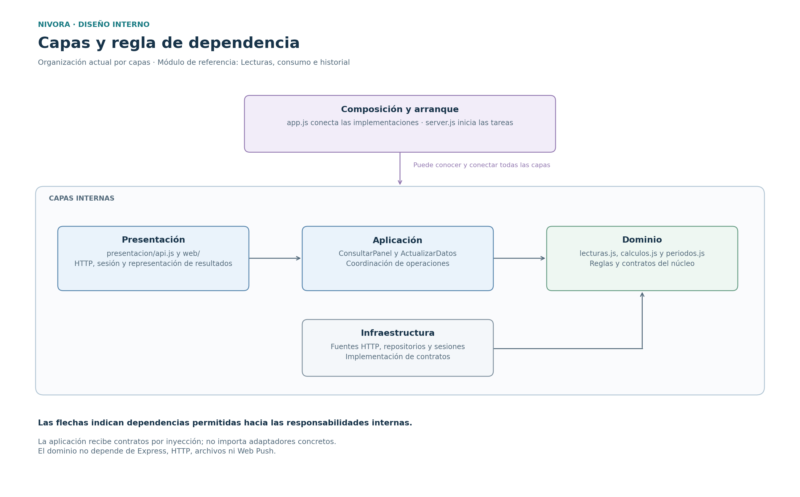
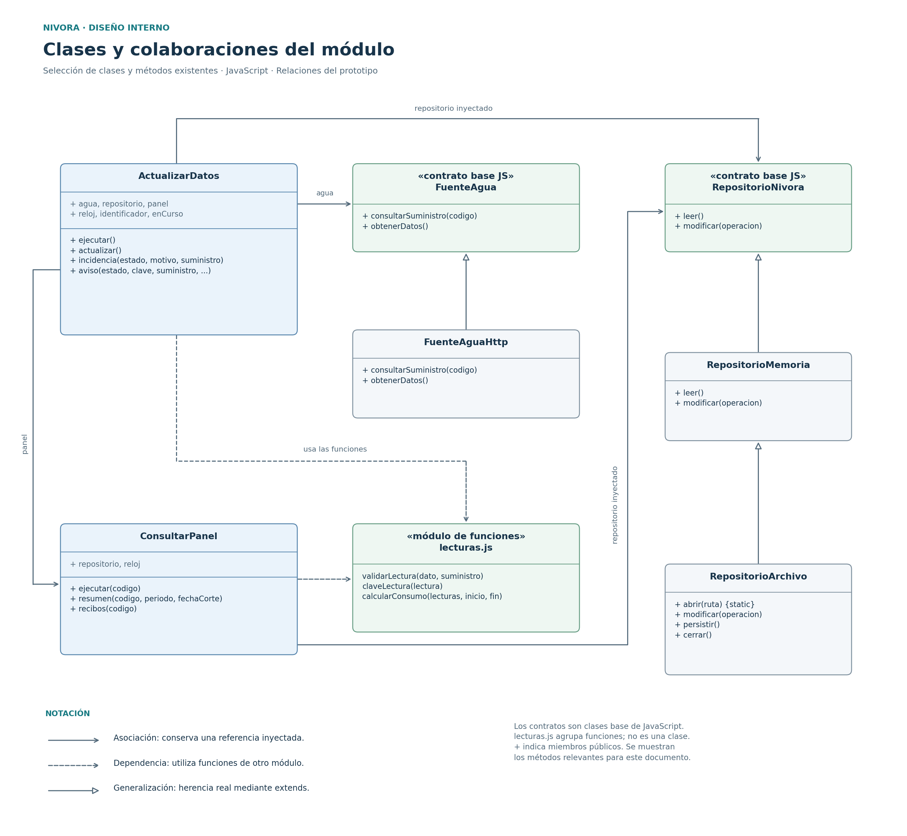
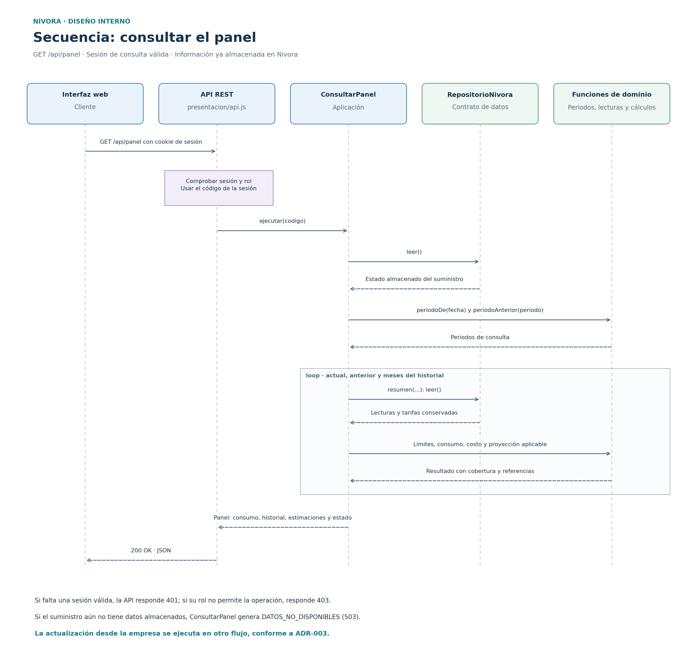

# Diseño interno de módulos de Nivora

**Proyecto:** Nivora.  
**Backend:** Node.js, JavaScript y Express.  
**Módulo de referencia:** Lecturas, consumo e historial.  
**Enfoque:** Clean Architecture en el backend de un monolito modular.

## 1. Propósito y alcance

Este documento describe las responsabilidades, los contratos, los métodos
y las colaboraciones internas que permiten incorporar lecturas y consultar
el consumo de agua en Nivora.

Se desarrolla un módulo de referencia, siguiendo la estructura del ejemplo
de diseño interno de la guía. Los cinco módulos del sistema se conservan
según el documento de
[componentes arquitectónicos](../../02-arquitectura-software/componentes-arquitectonicos.md).

La descripción se basa en los archivos del boilerplate revisados en el
commit `63a0f8e`. Su estructura actual está organizada por capas compartidas;
el módulo de referencia todavía no dispone de una carpeta independiente.
Los casos `ActualizarDatos` y `ConsultarPanel` también coordinan funciones
relacionadas con tarifas, costos, recibos y avisos.

La empresa de agua y la identidad utilizan servicios simulados.
La implementación de medidores inteligentes corresponde a la
infraestructura futura de la empresa. La integración real de identidad
con RENIEC y la posibilidad de realizar pagos mediante Yape pertenecen
a etapas posteriores.

## 2. Organización actual del código

Las rutas de esta tabla son relativas a
`tecnologia/nivora-boilerplate/`.

| Archivo o carpeta | Capa | Responsabilidad |
|-------------------|------|-----------------|
| `src/presentacion/web/` | Presentación | Mostrar el panel y permitir las acciones desde distintos dispositivos. |
| `src/presentacion/api.js` | Presentación | Registrar las rutas REST, comprobar la sesión y el rol, y traducir resultados y errores a HTTP. |
| `src/aplicacion/actualizar-datos.js` | Aplicación | Coordinar la incorporación de datos externos, las incidencias y la generación de avisos. |
| `src/aplicacion/consultar-panel.js` | Aplicación | Preparar consumo, historial, estimaciones y estado a partir de los datos conservados. |
| `src/dominio/lecturas.js` | Dominio | Validar y normalizar lecturas, construir sus claves y calcular el consumo y su cobertura. |
| `src/dominio/periodos.js` | Dominio | Determinar los límites de los periodos y las fechas utilizadas por las reglas del sistema. |
| `src/dominio/calculos.js` | Dominio | Calcular costos estimados, proyectar el consumo y comparar periodos para las alertas. |
| `src/dominio/errores.js` | Dominio | Representar los errores de negocio mediante `ErrorNivora`. |
| `src/dominio/contratos/puertos.js` | Dominio | Declarar las operaciones que requieren los casos de aplicación para fuentes externas, repositorio, sesiones y notificaciones. |
| `src/infraestructura/fuentes-http.js` | Infraestructura | Implementar los contratos de agua e identidad mediante las API HTTP simuladas. |
| `src/infraestructura/repositorio-memoria.js` | Infraestructura | Mantener el estado y ejecutar sus modificaciones sincrónicas. |
| `src/infraestructura/repositorio-archivo.js` | Infraestructura | Conservar el estado de la demostración en un archivo JSON. |
| `src/app.js` | Composición | Crear los adaptadores y casos de aplicación e inyectar sus colaboradores. |
| `src/server.js` | Arranque | Abrir el repositorio, iniciar los servidores y programar la actualización y la entrega de avisos. |

Esta documentación conserva los nombres y las rutas existentes.
Los diagramas seleccionan los elementos relevantes para explicar el módulo;
no representan la totalidad de clases y funciones del sistema.

## 3. Capas y regla de dependencia



[Versión vectorial del diagrama de capas](../../img/paquetes-lecturas-nivora.svg)

| Capa | Puede depender de | Responsabilidad y límite |
|------|-------------------|--------------------------|
| Dominio | Otros elementos del dominio | Contener reglas y contratos sin importar Express, HTTP, archivos ni bibliotecas de notificaciones. |
| Aplicación | Dominio y otros casos de aplicación cuando su colaboración esté justificada | Coordinar operaciones y usar los contratos recibidos, sin importar infraestructura ni presentación. |
| Infraestructura | Dominio, componentes de infraestructura y bibliotecas técnicas necesarias | Implementar los contratos con HTTP, archivos, memoria o Web Push. |
| Presentación | Casos de aplicación y herramientas de presentación | Traducir solicitudes y respuestas y aplicar los controles de entrada, sin elegir adaptadores concretos. |
| Composición y arranque | Las capas que necesita conectar | Seleccionar las implementaciones, construir los objetos y organizar su ciclo de vida. |

En JavaScript, los colaboradores se reciben como objetos mediante el
constructor. Los casos de aplicación utilizan sus operaciones sin importar
la clase concreta de infraestructura.

Por ejemplo, `ConsultarPanel` utiliza `repositorio.leer()` y no necesita
conocer si el repositorio conserva sus datos en memoria o en un archivo.
`ActualizarDatos` utiliza `agua.obtenerDatos()` y delega el HTTP en su
adaptador.

## 4. Datos y reglas del módulo

### 4.1 Lectura recibida y normalizada

Las lecturas se representan como objetos de datos de JavaScript.
El código actual no define una clase denominada `Lectura`.

| Campo | Significado |
|-------|-------------|
| `id`, `fuente` | Identificar la lectura dentro de su procedencia. |
| `suministro`, `medidor` | Relacionar la medición con un suministro reconocido y su medidor. |
| `fecha` | Indicar la fecha de medición con zona horaria. |
| `tipo` | Distinguir una lectura `acumulada` de una medición por `intervalo`. |
| `inicio` | Identificar el comienzo de una medición por intervalo. |
| `valor`, `unidad` | Conservar la cantidad recibida y su unidad, `L` o `m3`. |
| `valorLitros` | Conservar la cantidad normalizada en litros enteros después de la validación. |
| `recibidaEn` | Registrar cuándo Nivora incorporó la lectura aceptada. |

La fecha de recepción no sustituye la fecha de medición.
La información mostrada debe conservar esa distinción.

### 4.2 Reglas principales

| Regla | Comportamiento |
|-------|----------------|
| Validación | Exigir identificación, suministro y medidor compatibles, fecha con zona horaria, tipo admitido y cantidad no negativa representable en litros enteros. La lectura no puede superar la fecha de corte de la fuente. |
| Normalización | Convertir `m3` a litros mediante el factor 1000 y conservar los datos originales junto con `valorLitros`. |
| Duplicados | Usar la clave `fuente:suministro:id` y comprobar también la coincidencia de la medición. Un registro repetido no vuelve a incorporarse. |
| Conflictos | Si la identificación o la misma medición llegan con otros valores, registrar una incidencia y conservar la lectura ya aceptada. |
| Consumo acumulado | Restar la primera lectura válida de la última del periodo. Requerir al menos dos lecturas y detectar retrocesos del contador o cambios de medidor incompatibles. |
| Consumo por intervalos | Sumar los intervalos admitidos e identificar huecos o superposiciones. |
| Compatibilidad | Evitar mezclar lecturas acumuladas y de intervalo en el mismo cálculo. |
| Cobertura | Devolver el estado `sin_datos`, `parcial`, `completo` o `incompatible`, junto con fechas, referencias y motivo cuando corresponda. |
| Proyección | Aplicar la regla de ritmo promedio cuando el consumo tenga cobertura completa desde el inicio del periodo hasta su corte y exista al menos un día observado. |
| Alerta mensual | Comparar el acumulado actual con el total anterior cuando ambos resultados tengan la cobertura requerida. Identificar el evento para evitar avisos repetidos. |

Los importes se calculan en céntimos y se presentan como estimaciones.
El importe definitivo del recibo procede de la empresa.

## 5. Clases, contratos y métodos



[Versión vectorial del diagrama de clases](../../img/clases-lecturas-nivora.svg)

Los contratos `FuenteAgua` y `RepositorioNivora` están definidos como
clases base de JavaScript. Las flechas de generalización representan la
herencia utilizada con `extends`. El elemento `lecturas.js` representa
un módulo de funciones y se identifica expresamente en el diagrama.

| Elemento | Métodos o funciones relevantes | Responsabilidad |
|----------|--------------------------------|-----------------|
| `ActualizarDatos` | `ejecutar()`, `actualizar()`, `incidencia(...)`, `aviso(...)` | Coordinar un ciclo de incorporación, registrar incidencias y generar avisos sin repetir el evento. |
| `ConsultarPanel` | `ejecutar(codigo)` | Preparar el panel del suministro, incluyendo periodos, comparación, historial y estado de la integración. |
| `ConsultarPanel` | `resumen(codigo, periodo, fechaCorte)` | Preparar los resultados de un periodo: consumo, cobertura, tarifa, costo y proyección cuando corresponda. |
| `ConsultarPanel` | `recibos(codigo)` | Recuperar los recibos almacenados para la ruta correspondiente. |
| `lecturas.js` | `validarLectura(dato, suministro)` | Comprobar la lectura y devolver su representación normalizada. |
| `lecturas.js` | `claveLectura(lectura)` | Construir una clave estable para identificarla. |
| `lecturas.js` | `calcularConsumo(lecturas, inicio, fin)` | Calcular el consumo y explicar su cobertura y referencias. |
| `FuenteAgua` | `consultarSuministro(codigo)`, `obtenerDatos()` | Expresar las operaciones requeridas de la empresa. |
| `FuenteAguaHttp` | `consultarSuministro(codigo)`, `obtenerDatos()` | Implementar esas operaciones mediante HTTP. |
| `RepositorioNivora` | `leer()`, `modificar(operacion)` | Expresar el acceso al estado utilizado por los casos de aplicación. |
| `RepositorioMemoria` | `leer()`, `modificar(operacion)` | Mantener el estado y ejecutar un callback de modificación sincrónico. |
| `RepositorioArchivo` | `abrir(ruta)`, `modificar(operacion)`, `persistir()`, `cerrar()` | Extender el repositorio en memoria y organizar su escritura en JSON. |

En este contexto, `resumen()` significa preparar los resultados de un
periodo de consumo. Devuelve datos estructurados para la interfaz.

`ActualizarDatos.ejecutar()` conserva la promesa del ciclo activo en
`enCurso`. Si se solicita otra ejecución mientras sigue en curso,
reutiliza esa promesa para evitar ciclos simultáneos dentro de la instancia.

## 6. Flujo de ejecución: consultar el panel



[Versión vectorial del diagrama de secuencia](../../img/secuencia-consultar-panel-nivora.svg)

| Paso | Colaboración | Acción |
|------|--------------|--------|
| 1 | Interfaz → API REST | Enviar `GET /api/panel` con la cookie de sesión. |
| 2 | API REST → gestor de sesiones | Comprobar que la sesión existe y tiene el rol `consulta`. Obtener el suministro desde la sesión. |
| 3 | API REST → `ConsultarPanel` | Invocar `ejecutar(req.sesion.codigo)`. |
| 4 | `ConsultarPanel` → repositorio | Leer el estado conservado y comprobar que el suministro tenga datos almacenados. |
| 5 | `ConsultarPanel` → funciones de dominio | Determinar los periodos y preparar los resúmenes del mes actual, el anterior y los meses del historial. Cada resumen utiliza lecturas y tarifas conservadas. |
| 6 | `ConsultarPanel` → API REST | Devolver consumo, comparación, historial, estimaciones, última lectura y estado de la integración. |
| 7 | API REST → interfaz | Responder `200 OK` con el objeto JSON. La interfaz presenta los resultados y su actualidad. |

El diagrama agrupa las funciones de periodos, lecturas y cálculos
en una sola línea de vida. Los recibos y las notificaciones se consultan
mediante sus rutas correspondientes; no forman parte del objeto devuelto
por `GET /api/panel` en el boilerplate actual.

Si falta una sesión válida, la API responde `401`; si el rol no permite
la operación, responde `403`. Si el suministro aún no tiene información
almacenada, el caso genera `DATOS_NO_DISPONIBLES`, traducido a `503`.

La consulta utiliza datos propios de Nivora. La disponibilidad de la empresa
no condiciona una nueva llamada externa en cada consulta del panel.

## 7. Flujo independiente: actualizar datos

| Paso | Responsable | Acción |
|------|-------------|--------|
| 1 | `server.js` | Programar la ejecución periódica de la actualización. También existe una operación administrativa protegida para solicitarla. |
| 2 | `ActualizarDatos` | Controlar el ciclo activo y solicitar `agua.obtenerDatos()`. |
| 3 | `FuenteAguaHttp` | Consultar la API simulada y devolver sus datos o un error de comunicación. |
| 4 | `ActualizarDatos` | Comprobar la estructura de la respuesta y coordinar la incorporación de suministros y tarifas. |
| 5 | `ActualizarDatos` y `lecturas.js` | Validar cada lectura, normalizarla y comprobar duplicados y conflictos sobre el estado del repositorio. |
| 6 | `ActualizarDatos` | Incorporar lecturas nuevas con `recibidaEn`; registrar rechazos e incidencias. Incorporar recibos admitidos y generar sus avisos. |
| 7 | `ActualizarDatos` | Actualizar la fecha y el estado de la integración. Evaluar las condiciones de consumo utilizando el panel y las reglas del dominio. |
| 8 | Repositorio | Mantener el estado actualizado; el adaptador de archivo organiza su persistencia diferida. |

Si la fuente falla, se conserva la información aceptada y se registra
el estado de error. Las sesiones vigentes continúan consultando esos datos
con su fecha y estado, conforme a ADR-003.

La entrega de notificaciones se programa por separado y utiliza
`GestionarNotificaciones`. La recepción Web Push requiere sus condiciones
de configuración, permiso, conectividad y compatibilidad.

## 8. Código de referencia

Los siguientes fragmentos documentan el código existente. Las versiones
completas están en los archivos enlazados; los extractos no sustituyen
esos archivos.

### 8.1 Dominio: identificación de una lectura

Fragmento de
[`src/dominio/lecturas.js`](../../../tecnologia/nivora-boilerplate/src/dominio/lecturas.js):

```js
export function claveLectura(lectura) {
  return `${lectura.fuente}:${lectura.suministro}:${lectura.id}`;
}
```

La clave se utiliza junto con la comparación de los campos de la medición.
La validación de cantidades, fechas, unidades y correspondencia se realiza
en `validarLectura()`.

### 8.2 Dominio: contratos de agua y repositorio

Extracto de
[`src/dominio/contratos/puertos.js`](../../../tecnologia/nivora-boilerplate/src/dominio/contratos/puertos.js).
Se muestran las operaciones utilizadas en los flujos descritos:

```js
export class FuenteAgua {
  async consultarSuministro(codigo) { throw new Error('Implementar consultarSuministro'); }
  async obtenerDatos() { throw new Error('Implementar obtenerDatos'); }
}

export class RepositorioNivora {
  leer() { throw new Error('Implementar leer'); }
  modificar(operacion) { throw new Error('Implementar modificar'); }
}
```

### 8.3 Aplicación: preparar un periodo

Extracto de la clase `ConsultarPanel`, en
[`src/aplicacion/consultar-panel.js`](../../../tecnologia/nivora-boilerplate/src/aplicacion/consultar-panel.js):

```js
resumen(codigo, periodo, fechaCorte = null) {
  const estado = this.repositorio.leer();
  const { inicio, fin, dias } = limitesPeriodo(periodo);
  const lecturas = estado.lecturas.filter(l => l.suministro === codigo);
  const fechaFuente = estado.integracion.fechaFuente;
  const corte = fechaCorte ? Math.min(fin, Math.max(inicio, Date.parse(fechaCorte))) : fin;
  const consumo = calcularConsumo(lecturas, inicio, corte);
  consumo.metrosCubicos = consumo.litros === null ? null : consumo.litros / 1000;
  const tarifas = estado.tarifas.filter(t => t.suministro === codigo && Date.parse(t.vigenteDesde) <= inicio && Date.parse(t.vigenteHasta) >= corte);
  const tarifa = tarifas.at(-1) ?? null;
  const costo = consumo.litros !== null && tarifa ? calcularCosto(consumo.litros, tarifa) : null;
  const proyeccion = corte < fin ? proyectarConsumo(consumo, inicio, fin) : null;
  if (proyeccion && tarifa) proyeccion.costo = calcularCosto(proyeccion.litros, tarifa);
  return { periodo, dias, inicio: new Date(inicio).toISOString(), fin: new Date(fin).toISOString(), consumo, costo, tarifa, proyeccion, fechaFuente };
}
```

Los límites y cálculos proceden del dominio. La persistencia se utiliza
mediante el repositorio recibido por el constructor.

### 8.4 Infraestructura: consultar datos de la empresa

Extracto de la clase `FuenteAguaHttp`, en
[`src/infraestructura/fuentes-http.js`](../../../tecnologia/nivora-boilerplate/src/infraestructura/fuentes-http.js):

```js
obtenerDatos() {
  return consultar(this.base, '/agua/datos', this.secreto);
}
```

La función interna `consultar()` realiza el HTTP, configura el tiempo
límite y traduce los errores a `SERVICIO_NO_DISPONIBLE`.
La lectura de una respuesta HTTP no sustituye su validación de negocio.

### 8.5 Presentación: ruta del panel

Fragmento de
[`src/presentacion/api.js`](../../../tecnologia/nivora-boilerplate/src/presentacion/api.js):

```js
app.get('/api/panel', consulta, (req,res) => res.json(s.panel.ejecutar(req.sesion.codigo)));
```

`consulta` comprueba la sesión y el rol. El código de suministro procede
de la sesión que se creó después de validar el suministro y el DNI.
El acceso de consulta mantiene la regla de aceptar un suministro existente
y un DNI válido sin exigir titularidad.

### 8.6 Composición: conectar los colaboradores

Fragmentos de
[`src/app.js`](../../../tecnologia/nivora-boilerplate/src/app.js):

```js
const agua = new FuenteAguaHttp(baseSimulacion, secreto);
const panel = new ConsultarPanel({ repositorio, reloj });
const actualizacion = new ActualizarDatos({ agua, repositorio, panel, reloj, identificador });
```

El repositorio se abre en `server.js` y se entrega a `componer()`.
La aplicación recibe las instancias ya conectadas y conserva la separación
entre consulta, incorporación externa y entrega de avisos.

## 9. Verificación y límites actuales

| Aspecto | Comprobación relevante |
|---------|------------------------|
| Dependencias | Revisar las importaciones y utilizar `scripts/verificar-capas.js` para comprobar las restricciones estáticas del núcleo. |
| Exactitud e integridad | Ejecutar los casos definidos para lecturas acumuladas y por intervalo, unidades, cobertura, duplicados y conflictos. |
| Continuidad | Simular la caída de la empresa y comprobar las consultas de una sesión vigente con información conservada. |
| Contratos | Verificar que las fuentes devuelvan el formato esperado y que los errores externos se distingan de datos válidos. |
| Consistencia | Consultar el mismo suministro y corte de datos desde distintos dispositivos y comparar los resultados normalizados. |

El archivo JSON y las sesiones en memoria pertenecen a una demostración
de una sola instancia. La modificación del estado en memoria y su escritura
diferida no equivalen a una transacción durable de una base de datos.

Este avance incorpora documentación y diagramas. La integración real con
proveedores, la recepción en dispositivos físicos y las metas de carga
requieren la verificación establecida en los escenarios de calidad.

## 10. Trazabilidad

- Requisitos principales del módulo: RF05–RF14, RF19–RF21, RF32 y RF35–RF37.
- Colaboración con tarifas y proyecciones: RF15–RF18 y RF33.
- Colaboración con avisos y recibos: RF22–RF29 y RF34.
- Simulación de la fuente y sus escenarios: RF38 y RF39.
- Escenarios asociados: EQ-01, EQ-03, EQ-04, EQ-05, EQ-07, EQ-09 y EQ-10.
- [Escenarios de atributos de calidad](../../01-analisis-de-sistema/08-escenarios-atributos-calidad.md)
- [Componentes arquitectónicos](../../02-arquitectura-software/componentes-arquitectonicos.md)
- [ADR-001: Monolito modular](../../decisiones/ADR-001-monolito-modular.md)
- [ADR-002: Clean Architecture](../../decisiones/ADR-002-clean-architecture.md)
- [ADR-003: Actualización y continuidad](../../decisiones/ADR-003-actualizacion-y-continuidad.md)
- [ADR-004: Integraciones externas](../../decisiones/ADR-004-integraciones-externas.md)
