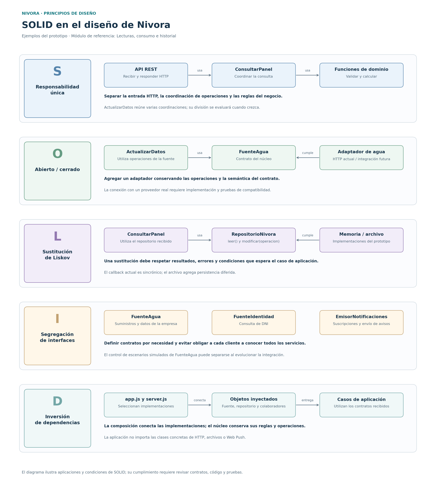

# Principios de diseño de Nivora (SOLID)

## Objetivo

Documentar cómo los principios SOLID orientan el diseño de Nivora,
con ejemplos del código existente y condiciones que deben conservarse
al modificarlo. La revisión toma como referencia el commit `13596c1`.

## Contexto

- **Estilo:** monolito modular con Node.js, JavaScript y Express.
- **Enfoque interno:** Clean Architecture, con presentación, aplicación, dominio e infraestructura.
- **Módulo de referencia:** Lecturas, consumo e historial, por su colaboración con la fuente de agua, el almacenamiento, los cálculos y los avisos.
- **Demostración actual:** empresa e identidad simuladas, persistencia JSON y sesiones en memoria para una sola instancia.

Los cinco módulos de negocio se conservan según la arquitectura.
Los ejemplos siguientes describen aplicaciones y oportunidades de mejora
de SOLID; organizar el código por capas no demuestra por sí solo
el cumplimiento completo de estos principios.

## SOLID en Nivora



[Versión vectorial del diagrama](../../img/solid-lecturas-nivora.svg)

Las rutas de la tabla son relativas a
`tecnologia/nivora-boilerplate/src/`.

| Principio | Aplicación en Nivora | Archivos de referencia | Condición que debe conservarse |
|-----------|----------------------|------------------------|--------------------------------|
| **S — Responsabilidad única** | La API trata las solicitudes HTTP, `ConsultarPanel` coordina la consulta y las funciones del dominio validan lecturas y calculan resultados. | `presentacion/api.js`, `aplicacion/consultar-panel.js`, `dominio/lecturas.js`, `dominio/calculos.js` | Mantener separadas las razones de cambio de presentación, coordinación y reglas. Revisar la división de casos que acumulen varias responsabilidades. |
| **O — Abierto/cerrado** | La integración puede ampliarse mediante un adaptador que conserve el contrato `FuenteAgua`, sin introducir las rutas o credenciales del proveedor en las reglas de consumo. | `dominio/contratos/puertos.js`, `infraestructura/fuentes-http.js`, `app.js` | Conservar operaciones, datos y errores esperados. Configurar el nuevo adaptador y comprobar su compatibilidad; los cambios de requisitos pueden exigir revisar el contrato. |
| **L — Sustitución de Liskov** | `RepositorioMemoria` y `RepositorioArchivo` ofrecen las operaciones de `RepositorioNivora`. Los casos reciben una implementación mediante composición. | `dominio/contratos/puertos.js`, `infraestructura/repositorio-memoria.js`, `infraestructura/repositorio-archivo.js` | Una implementación sustituta debe respetar el comportamiento esperado de `leer()` y `modificar(operacion)`, además de documentar sus condiciones de persistencia. La herencia por sí sola no lo garantiza. |
| **I — Segregación de interfaces** | Los contratos de agua, identidad, repositorio, sesiones y notificaciones agrupan necesidades diferentes. Cada caso recibe sus colaboradores. | `dominio/contratos/puertos.js`, `aplicacion/iniciar-sesion.js`, `aplicacion/notificaciones.js` | Evitar contratos que obliguen a los clientes a conocer operaciones ajenas a su función. En JavaScript estos contratos se expresan como clases base y operaciones acordadas. |
| **D — Inversión de dependencias** | Los casos de aplicación utilizan colaboradores inyectados; los adaptadores implementan los contratos del núcleo. La composición selecciona las clases concretas. | `aplicacion/actualizar-datos.js`, `aplicacion/consultar-panel.js`, `dominio/contratos/puertos.js`, `app.js`, `server.js` | Mantener las importaciones del núcleo dentro de las capas permitidas. Elegir las implementaciones HTTP, de archivo y de notificaciones en la composición. |

## Ejemplo de inversión de dependencias

En `app.js` se conectan los colaboradores. Estos fragmentos pertenecen
a la composición existente:

```js
const agua = new FuenteAguaHttp(baseSimulacion, secreto);
const panel = new ConsultarPanel({ repositorio, reloj });
const actualizacion = new ActualizarDatos({ agua, repositorio, panel, reloj, identificador });
```

`ConsultarPanel` utiliza `repositorio.leer()` y `ActualizarDatos` utiliza
`agua.obtenerDatos()`. Los casos no necesitan importar las clases concretas
de infraestructura para ejecutar esas operaciones.

El repositorio se abre en `server.js` y se entrega a `componer()`.
La aplicación conserva sus reglas, mientras la composición selecciona
los objetos que implementan las operaciones necesarias.

## Aplicación ante cambios del proyecto

| Cambio | Aplicación del principio | Comprobación necesaria |
|--------|-------------------------|-------------------------|
| Conectar una API real de la empresa | Implementar y seleccionar un adaptador compatible con las operaciones de agua. | Verificar formatos, errores, suministros, lecturas, tarifas y recibos contra el contrato. |
| Cambiar una regla de consumo | Modificar la función de dominio responsable. | Ejecutar los casos de exactitud, cobertura, duplicados y regresión afectados. |
| Sustituir el repositorio | Entregar otra implementación mediante composición. | Comprobar los resultados y las condiciones de sincronía, consistencia y persistencia que necesitan los casos. |
| Cambiar el mecanismo de envío de avisos | Implementar el contrato del emisor y conectarlo al caso de notificaciones. | Verificar suscripciones, errores y reintentos, además de la recepción cuando corresponda. |
| Cambiar la presentación del panel | Modificar la interfaz y la traducción HTTP que corresponda. | Mantener las reglas de cálculo y el contrato de respuesta utilizado por los dispositivos. |

## Aspectos por mejorar en el prototipo

- **Responsabilidad única:** `ActualizarDatos` coordina suministros, lecturas, tarifas, recibos y avisos. Su crecimiento puede justificar casos o colaboradores más específicos, conservando la coordinación del ciclo.
- **Segregación de interfaces:** `FuenteAgua` incluye `escenario(nombre)`, utilizado para controlar la simulación. Separar ese control permitiría que una fuente real exponga únicamente las operaciones que necesita su integración.
- **Contratos de persistencia:** `leer()` devuelve el estado compartido y los casos conocen su estructura. Operaciones específicas por responsabilidad permitirían reducir ese acoplamiento.
- **Sustitución:** `modificar(operacion)` requiere un callback sincrónico y `RepositorioArchivo` escribe de forma diferida. Una implementación asíncrona o con otras garantías exige revisar y verificar esas condiciones; no basta con conservar los nombres de los métodos.

Estas observaciones describen oportunidades de evolución. El avance
actual documenta el diseño sin modificar la implementación del boilerplate.

## Relación con Clean Architecture y los patrones

| Elemento del diseño | Relación con SOLID |
|--------------------|-------------------|
| Separación de presentación, aplicación, dominio e infraestructura | Ayuda a distribuir responsabilidades y controlar dependencias. |
| Adapter para agua, identidad y notificaciones | Facilita extender integraciones, manteniendo y verificando sus contratos. |
| Abstracción de repositorio | Separa el mecanismo de almacenamiento de su utilización en los casos de aplicación. |
| Contratos del núcleo | Expresan las operaciones acordadas y permiten evaluar segregación y sustitución. |
| Inyección de dependencias | Conecta implementaciones concretas sin hacer que el núcleo las seleccione. |

La revisión de importaciones, las pruebas de dominio y las pruebas de
contrato permiten comprobar partes de estas condiciones. El verificador
estático de capas no demuestra por sí solo responsabilidad única,
sustitución ni cumplimiento completo de SOLID.

La integración real con RENIEC y la posibilidad de pagos mediante Yape
corresponden a etapas posteriores. Sus adaptadores deberán definirse
y comprobarse cuando esas integraciones formen parte del alcance.

## Referencias del proyecto

- [Diseño interno de módulos](diseño-interno-de-modulos.md)
- [Patrones de diseño](patrones-de-diseño.md)
- [Componentes arquitectónicos](../../02-arquitectura-software/componentes-arquitectonicos.md)
- [Contratos del núcleo](../../../tecnologia/nivora-boilerplate/src/dominio/contratos/puertos.js)
- [Raíz de composición](../../../tecnologia/nivora-boilerplate/src/app.js)
- [Verificador de capas](../../../tecnologia/nivora-boilerplate/scripts/verificar-capas.js)
- [ADR-002: Clean Architecture](../../decisiones/ADR-002-clean-architecture.md)
- [ADR-004: Integraciones externas](../../decisiones/ADR-004-integraciones-externas.md)