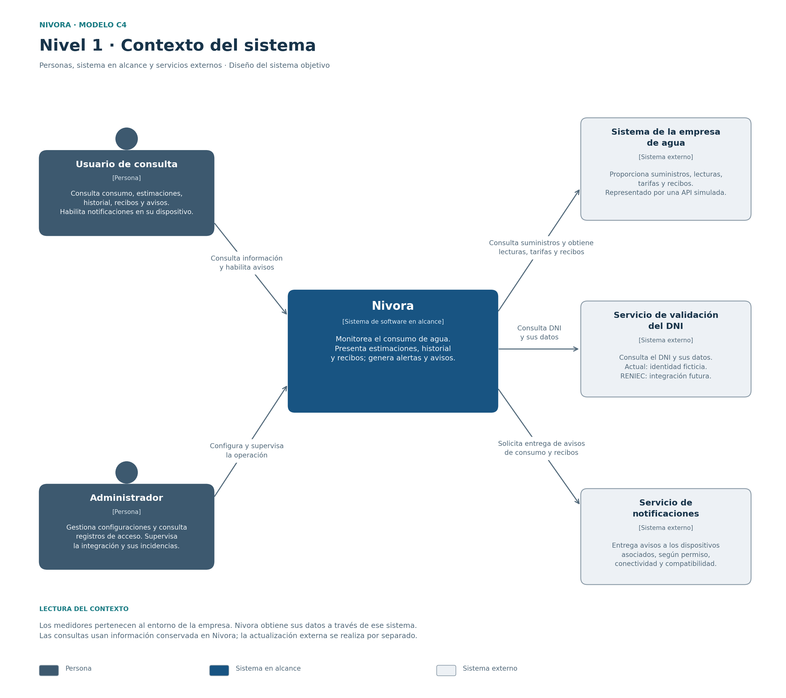

# Nivel 1 · Diagrama de contexto del sistema

**Proyecto:** Nivora.  
**Modelo:** C4 · Nivel 1.  
**Referencia del proyecto:** commit `ea7e456`.

## 1. Objetivo

Mostrar Nivora como un solo sistema, las personas que lo utilizan
y los servicios externos con los que se relaciona.

Esta vista permite comprender el propósito y los límites del sistema.
Los módulos, las clases, el almacenamiento y las tecnologías internas
se desarrollan en las otras vistas de arquitectura y diseño.

## 2. Diagrama

[Versión vectorial del diagrama](../img/nivel1-contexto-nivora.svg)

El diagrama representa el sistema objetivo y señala las integraciones
simuladas de la demostración. Las flechas identifican quién utiliza
una función o solicita una operación; las respuestas correspondientes
forman parte de esa interacción.

## 3. Personas

| Persona | Descripción | Interacción con Nivora |
|---------|-------------|-----------------------|
| Usuario de consulta | Persona que utiliza un suministro existente y un DNI válido, sin exigir titularidad. | Consulta consumo, costos estimados, proyección, historial, estadísticas, recibos y avisos. Puede habilitar la recepción de notificaciones en su dispositivo. |
| Administrador | Responsable de configurar y supervisar Nivora mediante un acceso diferenciado. | Consulta suministros y registros de acceso, gestiona configuraciones de periodos, tarifas y alertas, y supervisa la integración y sus incidencias. |

Las personas acceden desde celular, laptop o computadora.
La validación del DNI permite registrar el documento utilizado y los
datos devueltos; por sí sola no demuestra quién lo ingresó físicamente.

## 4. Sistemas

| Sistema | Tipo | Responsabilidad | Responsable |
|---------|------|-----------------|-------------|
| Nivora | Sistema en alcance | Facilitar el monitoreo del consumo de agua, preparar estimaciones y proyecciones, presentar recibos y generar alertas y avisos. | Equipo del proyecto. |
| Sistema de la empresa de agua | Sistema externo | Proporcionar suministros, lecturas, tarifas y recibos mediante su integración. | Empresa prestadora; el equipo del proyecto construye su simulación para la demostración. |
| Servicio de validación del DNI | Sistema externo | Comprobar la existencia del DNI y devolver los datos asociados al documento. | Proveedor de identidad por definir para la integración real; la demostración utiliza personas ficticias. |
| Servicio de notificaciones | Sistema externo | Recibir solicitudes de envío y entregar avisos a dispositivos asociados, según sus condiciones de funcionamiento. | Proveedor de entrega de notificaciones. |

Nivora decide cuándo generar los avisos. El servicio externo participa
en su entrega al dispositivo; los avisos también pueden consultarse
dentro de Nivora.

## 5. Relaciones

| Origen | Destino | Relación |
|--------|---------|----------|
| Usuario de consulta | Nivora | Accede con suministro y DNI, consulta información y habilita notificaciones. |
| Administrador | Nivora | Configura y supervisa la operación mediante sus permisos administrativos. |
| Nivora | Sistema de la empresa de agua | Verifica suministros y obtiene lecturas, tarifas y recibos. |
| Nivora | Servicio de validación del DNI | Consulta la existencia del documento y sus datos durante el acceso. |
| Nivora | Servicio de notificaciones | Solicita entregar avisos de consumo y disponibilidad de recibos a los dispositivos asociados. |

La integración con la empresa tiene dos usos: validar suministros
durante el acceso e incorporar información mediante una actualización
controlada. Las consultas del panel utilizan los datos conservados
en Nivora y no requieren una nueva lectura externa para responder.

## 6. Decisiones y supuestos

| Tema | Decisión o supuesto |
|------|--------------------|
| Medidores inteligentes | En el escenario futuro enviarán datos al sistema de la empresa. Su fabricación, instalación y comunicación quedan fuera del alcance de Nivora. |
| Fuente de información | Nivora se integra con el sistema de la empresa mediante su API. La primera etapa lo representa con una fuente simulada. |
| Acceso de consulta | Se acepta un suministro existente y cualquier DNI válido, sin comprobar titularidad. El acceso administrativo conserva un mecanismo y permisos diferenciados. |
| Identidad | Se simula la consulta de DNI con datos ficticios. La conexión real con RENIEC requiere definir y comprobar el servicio correspondiente. |
| Continuidad | Las sesiones vigentes pueden consultar información conservada durante una caída externa, acompañada de su fecha y estado. Un nuevo acceso que necesite una validación no disponible debe informar que no pudo completarla. |
| Estimaciones y recibos | Los costos acumulados y las proyecciones son estimaciones de Nivora. El importe definitivo procede del recibo de la empresa. |
| Entrega de avisos | Depende del permiso, la conectividad y la compatibilidad del dispositivo y del servicio. La aceptación del envío no acredita que el aviso se haya mostrado en pantalla. |
| Pagos | El procesamiento de pagos está fuera del alcance actual. La posibilidad de utilizar Yape se evaluará en una etapa posterior. |

## 7. Demostración y evolución

| Integración | Situación actual | Evolución prevista |
|-------------|------------------|--------------------|
| Empresa de agua | API simulada con suministros, lecturas, tarifas, recibos y escenarios de fallo. | Implementar y comprobar un adaptador compatible con la API real que se acuerde con la empresa. |
| Identidad | API simulada con personas ficticias. | Definir las condiciones y el adaptador de la integración con RENIEC. |
| Notificaciones | Adaptador Web Push incluido en el boilerplate. | Configurar el servicio y comprobar la recepción en dispositivos compatibles, incluso con la interfaz cerrada. |

Las funciones descritas corresponden al diseño del sistema. Su presencia
en esta vista no acredita que todos los requisitos, las integraciones
reales o las metas de capacidad ya estén verificados.

El siguiente avance será el nivel 2, documentado en
`Nivel2-DiagramadeContenedores.md`.

## 8. Referencias

- [Caso de estudio](../01-analisis-de-sistema/00-caso-de-estudio.md)
- [Actores de Nivora](../01-analisis-de-sistema/01-actores.md)
- [Escenarios de atributos de calidad](../01-analisis-de-sistema/08-escenarios-atributos-calidad.md)
- [Estilo arquitectónico](../02-arquitectura-software/estilo-arquitectonico.md)
- [ADR-003: Actualización y continuidad](../decisiones/ADR-003-actualizacion-y-continuidad.md)
- [ADR-004: Integraciones externas](../decisiones/ADR-004-integraciones-externas.md)
- [Modelo C4: diagrama de contexto del sistema](https://c4model.com/diagrams/system-context)