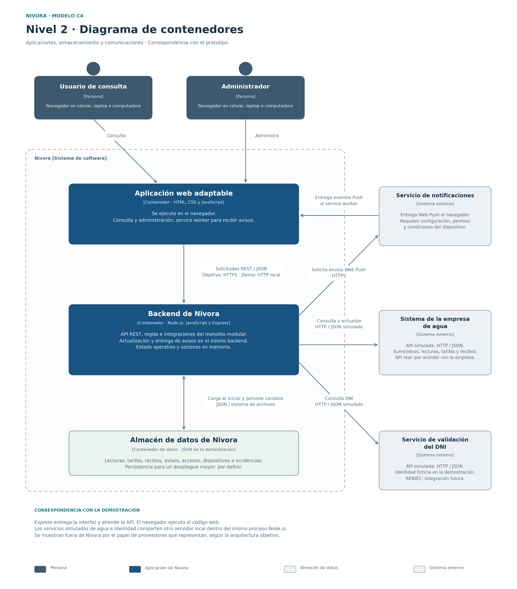

# Nivel 2 · Diagrama de contenedores

**Proyecto:** Nivora.  
**Modelo:** C4 · Nivel 2.  
**Referencia del proyecto:** commit `56a67c3`.

## 1. Objetivo

Abrir la vista de Nivora del nivel 1 para mostrar sus aplicaciones,
su almacenamiento, las tecnologías utilizadas y sus comunicaciones.

En C4, un contenedor representa una aplicación o un almacén de datos.
Esta clasificación no exige utilizar Docker ni determina por sí sola
servidores, réplicas o despliegues independientes.

## 2. Diagrama

[Versión vectorial del diagrama](../img/nivel2-contenedores-nivora.svg)

La frontera agrupa los contenedores propios de Nivora. Los sistemas
de empresa, identidad y notificaciones conservan las responsabilidades
externas definidas en el nivel 1. El diagrama indica la tecnología actual
y distingue la integración simulada de su evolución futura.

## 3. Contenedores de Nivora

| Contenedor | Tecnología | Responsabilidad | Datos que maneja |
|------------|------------|----------------|------------------|
| Aplicación web adaptable | HTML, CSS y JavaScript ejecutados en el navegador, con service worker para notificaciones. | Presentar el acceso de consulta y administración, consumo, estimaciones, historial, recibos y avisos. Comunicar las acciones a la API propia. | Estado de la interfaz y datos recibidos para su presentación. La sesión utiliza una cookie gestionada por el backend. |
| Backend de Nivora | Node.js, JavaScript y Express; monolito modular. | Exponer la API REST, comprobar sesiones y permisos, ejecutar reglas y casos de aplicación, integrar proveedores y coordinar la actualización y la entrega de avisos. | Estado operativo de suministros, lecturas, tarifas, recibos, avisos, dispositivos, accesos e incidencias. Las sesiones del prototipo permanecen en memoria. |
| Almacén de datos de Nivora | Archivo JSON local mediante `RepositorioArchivo` en la demostración. Persistencia de un despliegue mayor por definir. | Conservar el estado persistido para recuperarlo al iniciar la aplicación. | Datos aceptados, configuraciones, recibos, avisos, dispositivos, registros de acceso e incidencias. |

El archivo se representa como un almacén de datos C4. En el prototipo,
el repositorio carga su contenido al iniciar y mantiene el estado operativo
en memoria; las modificaciones organizan una escritura diferida en JSON.
Las consultas del panel utilizan ese estado conservado, sin releer el archivo
ni consultar la empresa como condición para responder.

## 4. Comunicaciones

| Origen | Destino | Interacción | Mecanismo |
|--------|---------|-------------|-----------|
| Usuario de consulta y administrador | Aplicación web | Utilizar la interfaz desde el navegador con los permisos correspondientes. | HTTPS en el despliegue objetivo; HTTP local en la demostración. |
| Aplicación web | Backend de Nivora | Enviar solicitudes de acceso, consultas y acciones; recibir resultados y errores. | API REST, JSON y cookie de sesión; HTTPS objetivo y HTTP local actual. |
| Backend de Nivora | Almacén de datos | Recuperar el estado al iniciar y persistir sus cambios. | Lectura y escritura de JSON mediante el sistema de archivos en la demostración. |
| Backend de Nivora | Sistema de la empresa de agua | Validar suministros y obtener lecturas, tarifas y recibos. | HTTP/JSON contra la API simulada. Se propone una API REST sobre HTTPS para la integración futura, sujeta al acuerdo con la empresa. |
| Backend de Nivora | Servicio de validación del DNI | Consultar la existencia del documento y sus datos durante el acceso. | HTTP/JSON contra la identidad simulada. Servicio, protocolo y condiciones de RENIEC por definir y comprobar. |
| Backend de Nivora | Servicio de notificaciones | Solicitar el envío de avisos a suscripciones admitidas. | Web Push mediante HTTPS, sujeto a configuración. |
| Servicio de notificaciones | Aplicación web en el dispositivo | Entregar un evento al service worker para mostrar el aviso. | Mecanismo Push del navegador, según permiso, conectividad y compatibilidad. |

El backend entrega también los archivos estáticos de la aplicación web.
La interfaz se ejecuta en el navegador aunque sus archivos procedan
del mismo servidor que atiende la API.

## 5. Organización del backend

El backend conserva los cinco módulos definidos: Acceso y suministros;
Lecturas, consumo e historial; Tarifas, costos y proyecciones;
Alertas y notificaciones; y Recibos.

La actualización controlada y la entrega de avisos se ejecutan
como tareas del mismo backend. Los módulos y sus colaboradores
se detallan en las vistas de componentes y diseño interno.

La actualización obtiene datos de la empresa, los valida e incorpora
sin duplicar mediciones ni eventos. Las consultas utilizan los datos
aceptados y muestran su fecha y estado, conforme a ADR-003.

El navegador presenta los resultados. Las reglas de consumo, costos,
proyecciones y alertas permanecen centralizadas en el backend.
Las llamadas a empresa e identidad se realizan desde sus adaptadores.
La entrega Push llega al navegador mediante el servicio correspondiente.

## 6. Correspondencia con la demostración

Las rutas de esta tabla son relativas a `tecnologia/nivora-boilerplate/`.

| Elemento | Implementación actual |
|----------|-----------------------|
| Aplicación web | `src/presentacion/web/`; Express entrega sus archivos. El service worker recibe eventos Push y no almacena respuestas de API ni datos personales en caché. |
| Backend | `src/app.js`, `src/presentacion/api.js` y las capas internas. El servidor propio utiliza el puerto 3000 por defecto. |
| Datos persistidos | `datos/nivora.json`, administrado por `src/infraestructura/repositorio-archivo.js` y su base en memoria. |
| Servicios simulados | `simulacion/servidor.js` ofrece las rutas de agua e identidad en el puerto 3001 por defecto. |
| Arranque y tareas | `src/server.js` inicia ambos servidores Express y programa la actualización y la entrega de avisos. |

Los dos servidores Express de la demostración se ejecutan dentro del
mismo proceso Node.js. Los simuladores representan proveedores externos
por su función en el diseño objetivo; esta vista no acredita aislamiento
entre procesos ni un despliegue independiente de esas fuentes.

## 7. Sesiones y comunicaciones protegidas

| Comunicación o dato | Medida del diseño y del prototipo |
|--------------------|----------------------------------|
| Navegador → API | Cookie de sesión `HttpOnly` y `SameSite=Strict`, con comprobación de sesión y rol en las operaciones protegidas. El despliegue HTTPS debe configurar la cookie `Secure`. |
| Consulta y administración | Accesos diferenciados y permisos comprobados por el backend. La consulta acepta un suministro existente y un DNI válido sin exigir titularidad. |
| Backend → proveedores | Credenciales y claves privadas conservadas en el backend y su configuración. El navegador recibe únicamente los datos necesarios, como la clave pública para la suscripción Push. |
| Acceso al almacenamiento | Lectura y modificación mediante el repositorio del backend; el archivo JSON pertenece al entorno local de demostración. |
| Recepción de avisos | Suscripción admitida, permiso y condiciones del dispositivo. La aceptación del envío se distingue de la recepción en pantalla. |

## 8. Evolución y capacidad

La persistencia JSON y las sesiones en memoria corresponden a una sola
instancia. La selección de almacenamiento y recursos para un despliegue
mayor se justificará mediante las pruebas de calidad. Si se utilizan
varias instancias, deberán compartirse los datos y sesiones y coordinarse
las tareas de actualización y notificación.

El diagrama no acredita la meta de 5000 usuarios simultáneos.
Su verificación corresponde a los escenarios de rendimiento y escalabilidad.

La conexión real con la empresa y RENIEC requiere definir y verificar
sus adaptadores. El procesamiento de pagos mediante una integración
compatible con Yape corresponde a una ampliación futura.

El siguiente avance será `Nivel3-Diagrama-de-Componentes.md`,
centrado en el interior del backend.

## 9. Referencias

- [Nivel 1: Contexto del sistema](Nivel1-DiagramadeContextodelSistema.md)
- [Componentes arquitectónicos](../02-arquitectura-software/componentes-arquitectonicos.md)
- [Diseño interno de módulos](../03-diseño-de-software/diseño-interno/diseño-interno-de-modulos.md)
- [Escenarios de atributos de calidad](../01-analisis-de-sistema/08-escenarios-atributos-calidad.md)
- [ADR-001: Monolito modular](../decisiones/ADR-001-monolito-modular.md)
- [ADR-003: Actualización y continuidad](../decisiones/ADR-003-actualizacion-y-continuidad.md)
- [ADR-004: Integraciones externas](../decisiones/ADR-004-integraciones-externas.md)
- [Arranque del boilerplate](../../tecnologia/nivora-boilerplate/src/server.js)
- [Modelo C4: diagrama de contenedores](https://c4model.com/diagrams/container)