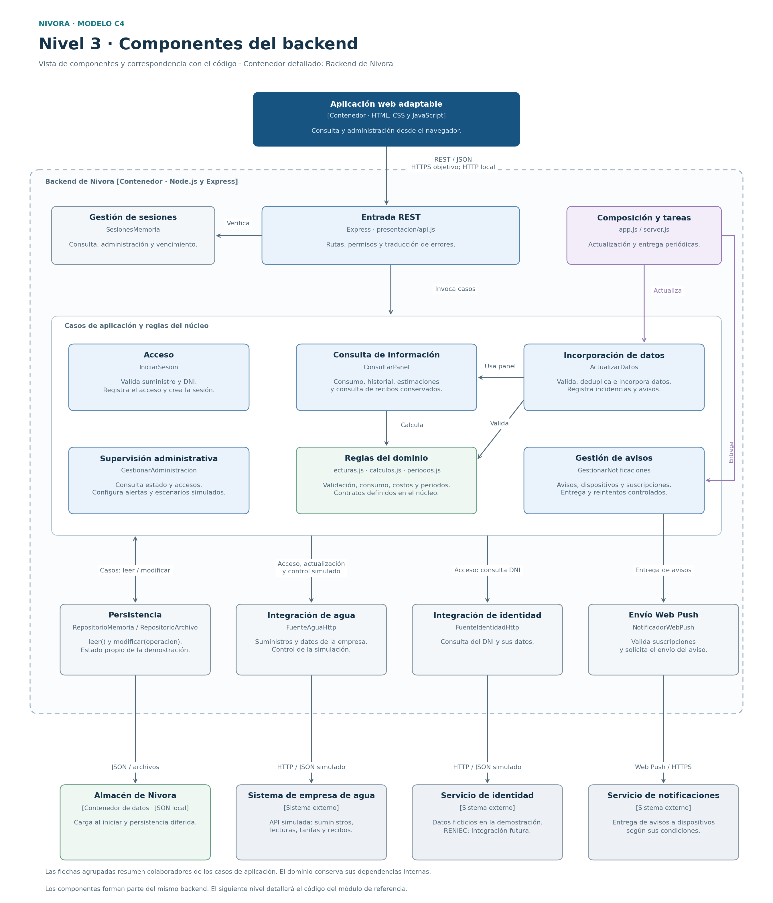

# Nivel 3 · Diagrama de componentes

**Proyecto:** Nivora.  
**Contenedor detallado:** Backend de Nivora.  
**Modelo:** C4 · Nivel 3.  
**Referencia del proyecto:** commit `73c6767`.

## 1. Objetivo

Detallar el interior del backend del nivel 2: sus componentes,
responsabilidades, colaboraciones y conexiones con el almacenamiento
y los sistemas externos.

La vista organiza los componentes por sus responsabilidades y los vincula
con el código existente. Los cinco módulos de negocio se conservan;
sus funciones se distribuyen entre casos de aplicación, reglas y adaptadores.

## 2. Diagrama

[Versión vectorial del diagrama](../img/nivel3-componentes-nivora.svg)

La frontera corresponde a un único contenedor de backend.
La aplicación web y el almacén de datos aparecen como contenedores
conectados. Empresa, identidad y notificaciones conservan su papel externo.

Las flechas muestran colaboraciones de ejecución. Las conexiones desde
el grupo de casos resumen colaboradores compartidos; no significan
que todos los casos utilicen todos los servicios. Las funciones del dominio
conservan la regla de dependencia descrita en el diseño interno.

## 3. Componentes y correspondencia con el código

Las rutas son relativas a `tecnologia/nivora-boilerplate/src/`.

| Componente | Responsabilidad | Implementación de referencia |
|------------|----------------|-------------------------------|
| Entrada REST | Recibir solicitudes, comprobar la sesión y el rol, invocar casos y traducir resultados y errores a HTTP. | `presentacion/api.js` |
| Gestión de sesiones | Crear, consultar, cerrar y depurar sesiones; comprobar las credenciales administrativas del prototipo. | `infraestructura/sesiones-memoria.js`, contrato `GestorSesiones` |
| Acceso | Validar el suministro y el DNI, registrar el acceso y crear la sesión de consulta o administrativa correspondiente. | `aplicacion/iniciar-sesion.js`: `IniciarSesion` |
| Consulta de información | Preparar consumo, historial, comparaciones, costos y proyecciones con datos conservados; ofrecer la consulta de recibos. | `aplicacion/consultar-panel.js`: `ConsultarPanel` |
| Incorporación de datos | Obtener datos de la empresa, validarlos, controlar duplicados, conservar registros e incidencias y generar avisos de consumo y recibos. | `aplicacion/actualizar-datos.js`: `ActualizarDatos` |
| Supervisión administrativa | Consultar estado, suministros, accesos e incidencias; habilitar o deshabilitar alertas y ejecutar escenarios simulados permitidos. | `aplicacion/administracion.js`: `GestionarAdministracion` |
| Gestión de avisos | Consultar y marcar avisos, gestionar dispositivos y suscripciones y coordinar entregas y reintentos. | `aplicacion/notificaciones.js`: `GestionarNotificaciones` |
| Reglas del dominio | Validar acceso y lecturas, calcular consumos, costos y proyecciones, comparar periodos y determinar fechas. Definir los contratos requeridos. | `dominio/acceso.js`, `lecturas.js`, `calculos.js`, `periodos.js`, `errores.js` y `contratos/puertos.js` |
| Persistencia | Proporcionar `leer()` y `modificar(operacion)` y organizar la conservación del estado en JSON en la demostración. | `infraestructura/repositorio-memoria.js`, `repositorio-archivo.js`, contrato `RepositorioNivora` |
| Integración de agua | Consultar suministros y obtener datos externos mediante el contrato de agua. Permitir el control simulado utilizado en la demostración. | `infraestructura/fuentes-http.js`: `FuenteAguaHttp` |
| Integración de identidad | Consultar el DNI y sus datos a través del contrato de identidad. | `infraestructura/fuentes-http.js`: `FuenteIdentidadHttp` |
| Envío Web Push | Validar suscripciones y adaptar el envío al servicio externo. | `infraestructura/notificador-web-push.js`: `NotificadorWebPush` |
| Composición y tareas | Conectar implementaciones, iniciar los servidores y programar la incorporación de datos y la entrega de avisos. | `app.js` y `server.js` |

## 4. Relación con los cinco módulos de negocio

| Módulo definido en la arquitectura | Componentes que participan en su implementación actual |
|-----------------------------------|------------------------------------------------------|
| Acceso y suministros | `IniciarSesion`, gestión de sesiones, validación de acceso, adaptadores de agua e identidad y operaciones de supervisión. |
| Lecturas, consumo e historial | `ActualizarDatos`, `ConsultarPanel`, funciones de lecturas y periodos, repositorio y supervisión de incidencias. |
| Tarifas, costos y proyecciones | Incorporación de tarifas en `ActualizarDatos`, preparación de resultados en `ConsultarPanel` y funciones de `calculos.js`. |
| Alertas y notificaciones | Evaluación y registro de avisos en `ActualizarDatos`, configuración administrativa, `GestionarNotificaciones` y adaptador Web Push. |
| Recibos | Incorporación y aviso de disponibilidad en `ActualizarDatos`, consulta mediante `ConsultarPanel.recibos()` y reglas de fechas. |

La organización física actual utiliza carpetas por capas compartidas.
La tabla no implica que exista una carpeta o una clase independiente
por cada módulo ni que todos sus requisitos ya estén implementados.

## 5. Colaboraciones principales

| Origen | Destino | Colaboración |
|--------|---------|--------------|
| Aplicación web | Entrada REST | Enviar solicitudes y recibir resultados mediante la API propia. |
| Entrada REST | Gestión de sesiones | Comprobar la sesión y el rol antes de ejecutar operaciones protegidas. |
| Entrada REST | Casos de aplicación | Dirigir cada solicitud al caso correspondiente mediante llamadas en el backend. |
| `IniciarSesion` | Adaptadores de agua e identidad | Comprobar la existencia del suministro y del DNI. Registrar el acceso y utilizar el gestor de sesiones para crear la sesión. |
| `ConsultarPanel` | Repositorio y reglas del dominio | Preparar resultados con lecturas, tarifas y recibos conservados. |
| Tarea de actualización | `ActualizarDatos` | Ejecutar la incorporación externa con control de un ciclo activo dentro de la instancia. |
| `ActualizarDatos` | Adaptador de agua, reglas, repositorio y panel | Obtener e incorporar datos; preparar la comparación necesaria y registrar avisos identificados para evitar duplicados. |
| `GestionarAdministracion` | Repositorio, adaptador de agua y actualización | Consultar estado, configurar alertas y aplicar escenarios simulados con posterior actualización. |
| Tarea de entrega | `GestionarNotificaciones` | Procesar avisos pendientes, dispositivos activos y reintentos. |
| `GestionarNotificaciones` | Repositorio y emisor Web Push | Consultar avisos, solicitar envíos y conservar sus resultados. |

Los avisos se generan mediante operaciones sobre el estado del repositorio.
La tarea de entrega los procesa posteriormente. El prototipo no utiliza
un bus de eventos ni implementa Observer para esta colaboración.

## 6. Conexiones externas al contenedor

| Componente interno | Destino | Interacción y mecanismo |
|--------------------|---------|-------------------------|
| Entrada REST | Aplicación web | REST y JSON; HTTPS en el objetivo y HTTP local en la demostración. El backend entrega también los archivos estáticos. |
| Repositorio de archivo | Almacén de datos de Nivora | Leer JSON al iniciar y persistir cambios de forma diferida mediante el sistema de archivos. El estado operativo permanece en memoria. |
| `FuenteAguaHttp` | Sistema de la empresa de agua | HTTP/JSON contra la fuente simulada. La integración real requiere acordar y comprobar su API. |
| `FuenteIdentidadHttp` | Servicio de validación del DNI | HTTP/JSON con personas ficticias en la demostración. La integración real con RENIEC permanece pendiente. |
| `NotificadorWebPush` | Servicio de notificaciones | Solicitud de envío Web Push mediante HTTPS, con configuración y suscripción admitidas. |

El servicio de notificaciones entrega los eventos al service worker de la
aplicación web, conforme al nivel 2. Esa recepción depende del permiso,
la conectividad y la compatibilidad del dispositivo. La aceptación del
envío no demuestra que el aviso se haya mostrado en pantalla.

## 7. Reglas de organización

1. Los componentes forman parte del mismo backend y se comunican
   mediante llamadas internas y contratos acordados.
2. La composición selecciona los adaptadores concretos. El dominio
   y la aplicación conservan las dependencias permitidas por Clean Architecture.
3. Las consultas del panel utilizan información conservada. La actualización
   externa y la entrega se coordinan en tareas separadas de esas consultas.
4. El acceso de consulta requiere un suministro existente y un DNI válido
   sin exigir titularidad. La administración utiliza su autenticación y permisos.
5. Las lecturas inválidas o conflictivas se registran como incidencias;
   los duplicados no incrementan el consumo ni repiten el mismo evento.
6. Los costos y las proyecciones son estimaciones. Los importes definitivos
   proceden de los recibos de la empresa.
7. El contrato actual del repositorio expone el estado compartido y utiliza
   callbacks sincrónicos. Los límites por módulo requieren evolución
   y verificación; no se presupone una separación física de sus datos.

El documento describe la organización del diseño y su correspondencia
con el prototipo. La capacidad, las integraciones reales y la recepción
en dispositivos requieren las comprobaciones definidas en calidad.
Los pagos mediante Yape corresponden a una ampliación futura.

El siguiente avance será `Nivel4-DiagramadeCodigo.md`, tomando como
referencia el módulo Lecturas, consumo e historial.

## 8. Referencias

- [Nivel 2: Contenedores](Nivel2-DiagramadeContenedores.md)
- [Componentes arquitectónicos](../02-arquitectura-software/componentes-arquitectonicos.md)
- [Diseño interno de módulos](../03-diseño-de-software/diseño-interno/diseño-interno-de-modulos.md)
- [Patrones de diseño](../03-diseño-de-software/diseño-interno/patrones-de-diseño.md)
- [Principios de diseño](../03-diseño-de-software/diseño-interno/principios-de-diseño.md)
- [Composición del backend](../../tecnologia/nivora-boilerplate/src/app.js)
- [Contratos del núcleo](../../tecnologia/nivora-boilerplate/src/dominio/contratos/puertos.js)
- [ADR-003: Actualización y continuidad](../decisiones/ADR-003-actualizacion-y-continuidad.md)
- [ADR-004: Integraciones externas](../decisiones/ADR-004-integraciones-externas.md)
- [Modelo C4: diagrama de componentes](https://c4model.com/diagrams/component)