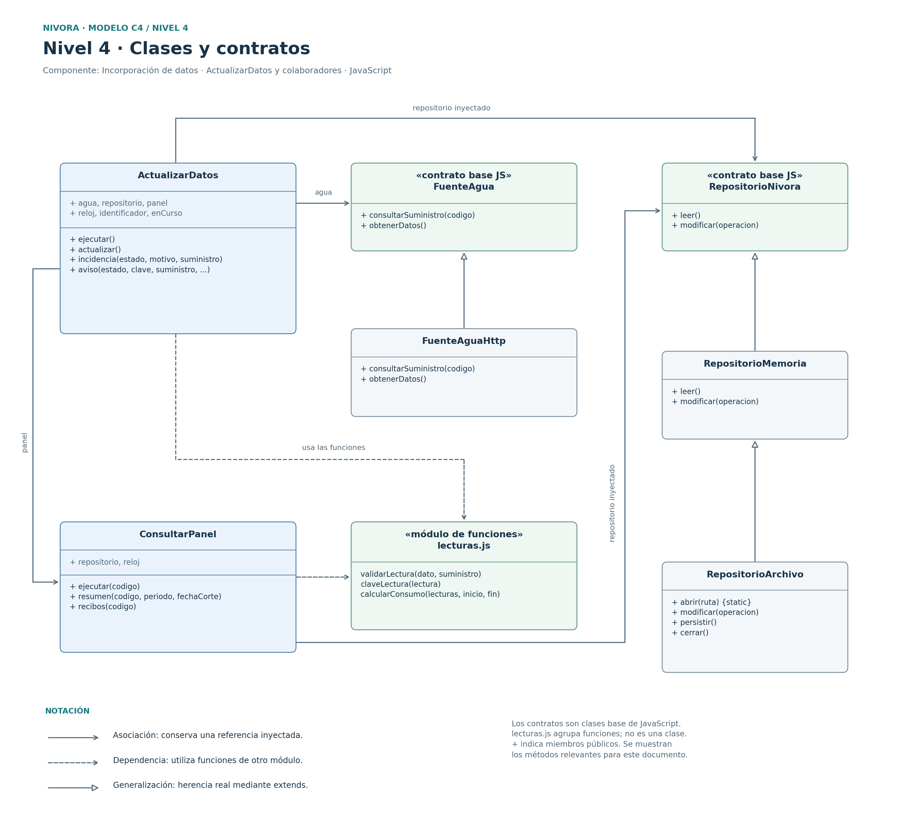
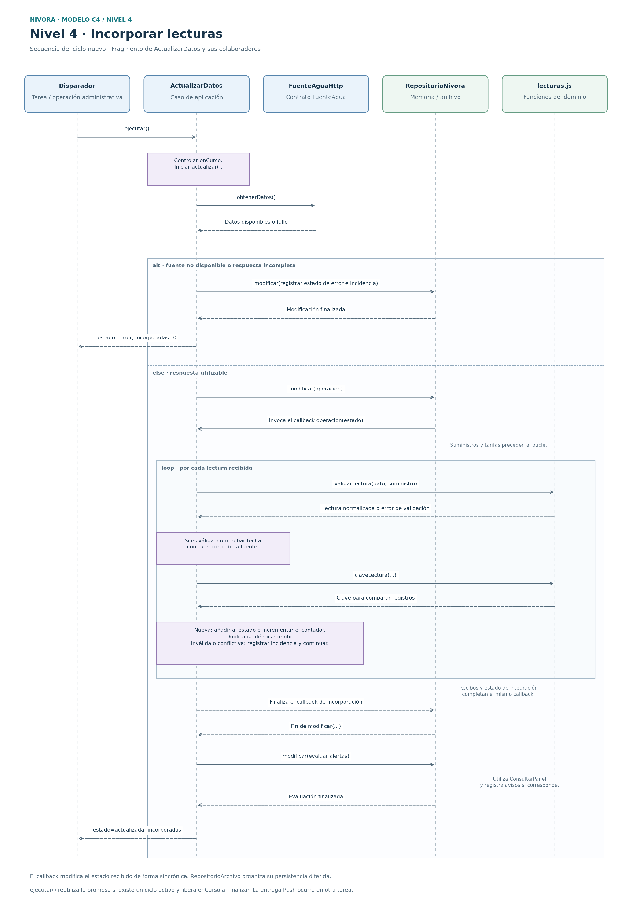

# Nivel 4 · Diagrama de código

**Proyecto:** Nivora.  
**Módulo de referencia:** Lecturas, consumo e historial.  
**Componente detallado:** Incorporación de datos, mediante `ActualizarDatos`.  
**Modelo:** C4 · Nivel 4.  
**Notación:** UML, con clases y módulos de funciones de JavaScript.  
**Referencia del proyecto:** commit `4c20cfe`.

## 1. Objetivo y alcance

Detallar el código del componente de incorporación presentado en el nivel 3.
Se selecciona el flujo de validación e incorporación de lecturas porque
concentra la integración con la empresa, el control de duplicados,
el registro de incidencias y la continuidad ante fallos externos.

El diagrama de clases incluye los contratos y colaboradores relevantes.
La secuencia desarrolla ese flujo dentro del ciclo que también incorpora
suministros, tarifas y recibos y evalúa condiciones de alerta.

## 2. Diagrama de clases y contratos

[Versión vectorial del diagrama de clases](../img/nivel4-clases-nivora.svg)

### 2.1 Elementos del código

Las rutas son relativas a `tecnologia/nivora-boilerplate/src/`.

| Elemento | Tipo y capa | Responsabilidad | Archivo |
|----------|-------------|----------------|---------|
| `ActualizarDatos` | Clase de aplicación | Coordinar la incorporación, evitar ciclos simultáneos en la instancia y registrar incidencias y avisos. | `aplicacion/actualizar-datos.js` |
| `ConsultarPanel` | Clase de aplicación, colaboradora | Preparar resultados desde datos conservados para evaluar la comparación de consumos. | `aplicacion/consultar-panel.js` |
| `FuenteAgua` | Contrato mediante clase base del dominio | Declarar las operaciones requeridas de la fuente de agua. | `dominio/contratos/puertos.js` |
| `FuenteAguaHttp` | Adaptador de infraestructura | Obtener suministros y datos mediante la API simulada. | `infraestructura/fuentes-http.js` |
| `RepositorioNivora` | Contrato mediante clase base del dominio | Declarar `leer()` y `modificar(operacion)`. | `dominio/contratos/puertos.js` |
| `RepositorioMemoria` | Repositorio de infraestructura | Mantener el estado y ejecutar callbacks de modificación sincrónicos. | `infraestructura/repositorio-memoria.js` |
| `RepositorioArchivo` | Repositorio de infraestructura | Extender el repositorio en memoria y organizar la persistencia diferida en JSON. | `infraestructura/repositorio-archivo.js` |
| `lecturas.js` | Módulo de funciones del dominio | Validar y normalizar lecturas, construir claves y calcular consumo y cobertura. | `dominio/lecturas.js` |

Las lecturas son objetos de datos; el prototipo no define una clase
`Lectura`. Las funciones de `lecturas.js` se identifican como tales
en el diagrama. Se muestran los métodos relevantes, no todos los miembros
de cada clase.

### 2.2 Notación y dependencias

| Notación | Significado en este diseño |
|----------|----------------------------|
| Línea continua con flecha abierta | Referencia conservada por inyección, como `agua`, `repositorio` o `panel`. |
| Línea discontinua con flecha abierta | Uso de funciones de otro módulo. |
| Línea continua con triángulo hueco | Herencia implementada con `extends`, como `FuenteAguaHttp` → `FuenteAgua`. |
| `+` | Miembro público en las clases mostradas. |
| `«módulo de funciones»` | Agrupación de funciones exportadas, no una clase de JavaScript. |

La aplicación utiliza los colaboradores recibidos. La composición
selecciona los adaptadores concretos. El dominio conserva sus reglas
y contratos sin importar HTTP, Express, archivos ni Web Push.

## 3. Diagrama de secuencia: incorporar lecturas

[Versión vectorial del diagrama de secuencia](../img/nivel4-secuencia-nivora.svg)

| Paso | Colaboración | Acción |
|------|--------------|--------|
| 1 | Tarea programada u operación administrativa → `ActualizarDatos` | Invocar `ejecutar()`. Si existe un ciclo activo, reutilizar su promesa. |
| 2 | `ActualizarDatos` → fuente de agua | Ejecutar `obtenerDatos()` y comprobar que la respuesta tenga la estructura requerida. |
| 3 | Alternativa de fallo | Registrar el estado de error y la incidencia mediante el repositorio. Conservar los datos aceptados y devolver `{ estado: 'error', incorporadas: 0 }`. |
| 4 | Respuesta utilizable → repositorio | Ejecutar `modificar(operacion)`. El repositorio invoca el callback con el estado disponible. |
| 5 | Callback de incorporación | Procesar suministros y tarifas antes del bucle de lecturas. |
| 6 | `ActualizarDatos` → funciones de lecturas | Validar cada lectura, normalizar su cantidad a litros y comprobar que no supere el corte temporal de la fuente. |
| 7 | Callback de incorporación | Comparar la clave y los campos de la medición contra los registros conservados. |
| 8 | Lectura nueva | Añadirla al estado con `recibidaEn` e incrementar `incorporadas`. |
| 9 | Duplicado, dato inválido o conflicto | Omitir un duplicado idéntico. Registrar una incidencia ante un dato inválido o conflictivo y continuar con los demás registros. |
| 10 | Callback de incorporación | Procesar los recibos y completar el estado de la integración. |
| 11 | `ActualizarDatos` → repositorio y panel | Ejecutar la fase de evaluación de alertas, cuando estén habilitadas, y registrar los avisos que correspondan. |
| 12 | `ActualizarDatos` → disparador | Devolver `{ estado: 'actualizada', incorporadas }` al completar el ciclo normal. Liberar el control `enCurso` al finalizar la promesa. |

La línea de vida del repositorio representa el contrato recibido;
en la demostración puede utilizar memoria o archivo. El callback modifica
el estado de forma sincrónica. La escritura diferida del archivo no implica
que cada lectura se guarde mediante una transacción independiente.

La aceptación de la respuesta de la fuente puede coexistir con incidencias
por registros individuales rechazados. `incorporadas` cuenta únicamente
las lecturas nuevas admitidas, no suministros, tarifas ni recibos.

## 4. Validación y control de duplicados

| Situación | Comportamiento del código |
|-----------|--------------------------|
| Identificación, suministro o medidor incompatibles | Rechazar la lectura y registrar el motivo. |
| Cantidad, unidad, fecha o intervalo inválidos | Rechazar la lectura mediante `validarLectura()`. La normalización admite litros enteros no negativos. |
| Fecha posterior a `fechaFuente` | Rechazar la lectura por superar el corte de la fuente. |
| Misma clave y mismos campos | Omitir el registro ya incorporado. |
| Misma clave con otros campos | Registrar conflicto y conservar la lectura aceptada previamente. |
| Otra identificación para la misma medición | Comparar los campos; omitir si coinciden y registrar incidencia si presentan valores incompatibles. |
| Fallo externo | Mantener los datos conservados y registrar el intento fallido. Las consultas de sesiones vigentes continúan con su fecha y estado. |

La clave se construye con `fuente:suministro:id`. La comprobación adicional
de la medición utiliza suministro, medidor, fecha, tipo e inicio del intervalo.
La comparación de valores incorpora también `valorLitros`.

Las reglas de consumo interpretan después las lecturas admitidas como
acumuladas o por intervalos y determinan su cobertura. Incorporar una
lectura no equivale por sí solo a disponer de un periodo completo.

## 5. Patrones y principios visibles

| Elemento | Patrón o principio relacionado |
|----------|--------------------------------|
| `FuenteAguaHttp` y contrato `FuenteAgua` | Adapter para aislar la comunicación HTTP. |
| Contrato e implementaciones del repositorio | Abstracción simplificada de persistencia, descrita en patrones de diseño. |
| Colaboradores recibidos por el constructor | Inyección de dependencias e inversión de dependencias. |
| Funciones del dominio separadas de HTTP y archivos | Separación de responsabilidades y regla de dependencia. |
| Implementaciones intercambiables | Sustitución sujeta a conservar la semántica y las condiciones del contrato, incluidas sincronía y persistencia. |

`ActualizarDatos` coordina también tarifas, recibos y avisos. Su posible
división se mantiene como oportunidad de mejora documentada en SOLID.
La entrega de notificaciones se procesa en otra tarea del backend;
no forma parte del flujo de incorporación detallado.

## 6. Pruebas de referencia

| Archivo existente | Casos relacionados con esta vista |
|-------------------|-----------------------------------|
| `pruebas/dominio.test.js` | Validación de lecturas, conversión de m³ a litros, consumo acumulado, intervalos, cobertura y retroceso del contador. |
| `pruebas/integracion.test.js` | Duplicados, exclusión de lecturas inválidas, aviso único de consumo, conservación de consultas durante una caída y disponibilidad de recibos sin avisos repetidos. |

La revisión del código identifica además comprobaciones de conflicto
por identificación y por medición. Sus casos específicos deberán formar
parte de la verificación de exactitud e integridad definida en calidad.

Esta vista completa la documentación de los cuatro niveles C4.
La capacidad y las integraciones reales se comprueban mediante sus
pruebas y evidencias, según los escenarios de calidad del proyecto.

## 7. Referencias

- [Nivel 3: Componentes](Nivel3-Diagrama-de-Componentes.md)
- [Diseño interno de módulos](../03-diseño-de-software/diseño-interno/diseño-interno-de-modulos.md)
- [Patrones de diseño](../03-diseño-de-software/diseño-interno/patrones-de-diseño.md)
- [Principios de diseño](../03-diseño-de-software/diseño-interno/principios-de-diseño.md)
- [Caso de aplicación ActualizarDatos](../../tecnologia/nivora-boilerplate/src/aplicacion/actualizar-datos.js)
- [Funciones de lecturas](../../tecnologia/nivora-boilerplate/src/dominio/lecturas.js)
- [Pruebas del dominio](../../tecnologia/nivora-boilerplate/pruebas/dominio.test.js)
- [Pruebas de integración](../../tecnologia/nivora-boilerplate/pruebas/integracion.test.js)
- [Escenarios de atributos de calidad](../01-analisis-de-sistema/08-escenarios-atributos-calidad.md)
- [ADR-003: Actualización y continuidad](../decisiones/ADR-003-actualizacion-y-continuidad.md)
- [Modelo C4: diagrama de código](https://c4model.com/diagrams/code)